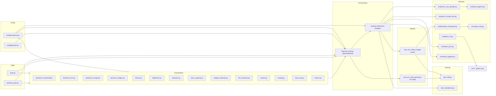
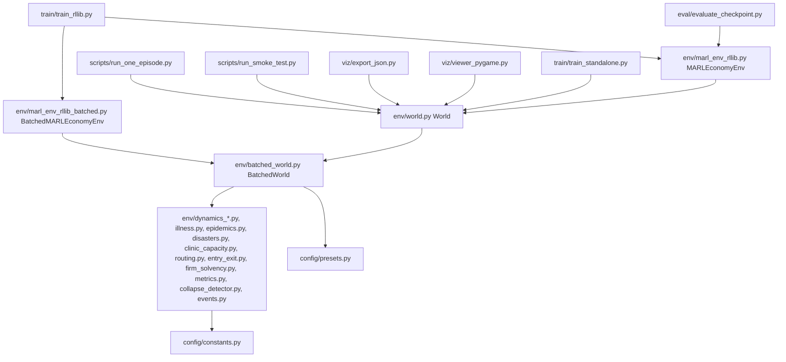
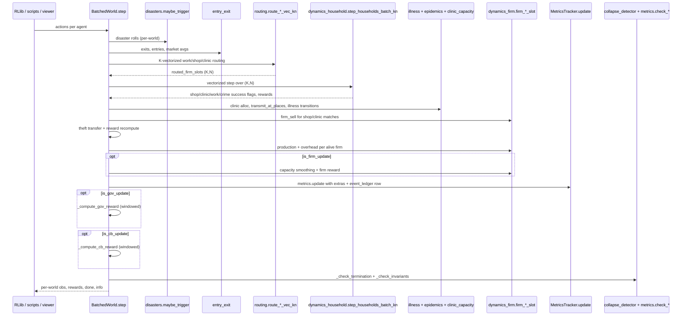
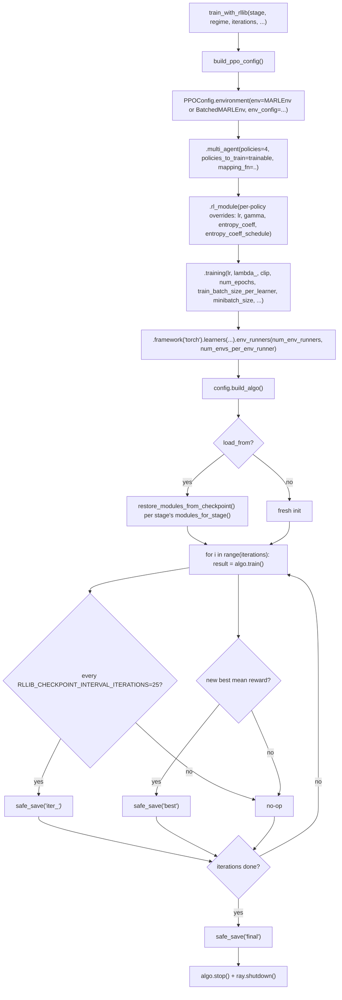

# Architecture Review: `marl_economy`

## 1. Scope

This document is a code-grounded architecture reference for the repository at
`C:\Users\Baris Kaan\Desktop\marl_economy`, captured against the source as of
2026-05-14. It covers every top-level directory, every source file under
`marl_economy/`, the actual runtime flow through `BatchedWorld.step`, the
state model after the struct-of-arrays migration, the human-condition stack
(hunger, fatigue, illness, place-based epidemics), the disaster generator,
the clinic-capacity triage, firm solvency gating, routing and matching, the
multi-signal collapse detector, the typed event ledger, the two RLlib
adapter variants, and the full PPO training pipeline including
per-policy learning-rate multipliers and entropy schedules.

The review is based on direct source inspection. Every numerical value cited
appears verbatim in `marl_economy/config/constants.py`. Every reference of
the form `file:line` was checked against the current code.

## 2. Executive Summary

The project is a small multi-agent RL simulator of a synthetic economy with
four agent classes acting on different timescales - households (weekly),
firms (every 4 weeks), government (every 12 weeks), central bank (every
12 weeks).

Three structural facts shape the codebase:

1. As of the 2026-05-14 refactor, `World` in `marl_economy/env/world.py`
   is a thin wrapper around `BatchedWorld(K=1)`. The economic dynamics
   are implemented exactly once, in `marl_economy/env/batched_world.py`
   plus the vectorized helpers in `dynamics_*.py`, `routing.py`, and
   the small physics/illness/epidemic/disaster modules.
2. Per-agent state is stored as struct-of-arrays in
   `BatchedHouseholdState` (shape `(K, N)`) and `BatchedFirmState`
   (shape `(K, F_max)`) - never as `list[dict]` in the current code.
3. The simulator's behavior is reproducible per-seed across K because
   `BatchedWorld` spawns one `np.random.Generator` per world via
   `SeedSequence.spawn(K)`. `BatchedWorld(K=K1, seed=s)[world i]` and
   `BatchedWorld(K=K2, seed=s)[world i]` produce identical trajectories.

Layered on top of the four learning agents:

- A human-condition stack (hunger, fatigue, five-state illness machine)
  driven by per-household susceptibility multipliers in
  `marl_economy/env/illness.py`.
- A place-based epidemic transmission model
  (`marl_economy/env/epidemics.py`) using `P = 1 - (1 - α)^k`.
- An exogenous disaster generator with five disaster types
  (`marl_economy/env/disasters.py`).
- A clinic-capacity allocator with severity-based triage
  (`marl_economy/env/clinic_capacity.py`).
- A multi-signal economic-collapse detector
  (`marl_economy/env/collapse_detector.py`) with three sub-reasons
  beyond the trivial "no firms" case.
- A typed event ledger with 20 distinct event types
  (`marl_economy/env/events.py`).
- A firm solvency hire gate with five predicates
  (`marl_economy/env/firm_solvency.py`).

Training uses Ray RLlib PPO via two adapters:
`marl_env_rllib.MARLEconomyEnv` for single-world rollouts and
`marl_env_rllib_batched.BatchedMARLEconomyEnv` for K-parallel rollouts
inside one env runner. PPO hyperparameters are
`PPO_TRAIN_BATCH_SIZE = 8192`, `PPO_MINIBATCH_SIZE = 1024`,
`PPO_LR = 3e-4`, `PPO_CLIP = 0.2`, `PPO_GAE_LAMBDA = 0.95`,
`PPO_VF_LOSS_COEFF = 0.5`, `PPO_GRAD_CLIP = 0.5`,
`PPO_NUM_SGD_ITER = 10`, network `[256, 256]`.

## 3. Repository Map

### 3.1 Top-level files

| Path | Purpose |
| --- | --- |
| `README.md` | Quick start and regime/stage overview. |
| `docs/architecture.md` | This document. |
| `docs/notebooklm_presentation.md` | Audio-overview script (40-45 min). Reads more loosely than this file; see the audit at the end of section 23 for any divergences. |
| `pyproject.toml` | Package metadata and base dependencies. |
| `requirements.txt` | Flat dependency list. |
| `marl_economy/` | All source. |
| `runs/` | Generated at runtime (not included in this distribution). |
| `tests/`, `unity/` | Auxiliary directories not in the runtime path. |
| `*.bat`, `*.cmd` (e.g. `train.bat`) | Launcher scripts at the repo root. |
| `scripts/*.py` (e.g. `scripts/sanity_run_v4.py`, `scripts/stage3_test*.py`, `scripts/benchmark_stage*.py`) | Validation harnesses moved from repo root into scripts/. |

### 3.2 Source-package directory tree

```text
marl_economy/
├── __init__.py
├── config/
│   ├── __init__.py
│   ├── constants.py            1053 lines - every numerical value
│   └── presets.py              49 lines - regime accessor helpers
├── env/
│   ├── __init__.py
│   ├── batched_state.py        227 lines - BatchedHouseholdState, BatchedFirmState
│   ├── batched_world.py        1745 lines - orchestrator for K-parallel worlds (the actual implementation)
│   ├── clinic_capacity.py      49 lines - weekly_capacity + severity-priority allocator
│   ├── collapse_detector.py    89 lines - multi-signal terminator
│   ├── disasters.py            232 lines - five disaster types + counters
│   ├── dynamics_fatigue.py     66 lines - fatigue rise/fall + productivity/health bonuses
│   ├── dynamics_firm.py        232 lines - slot-indexed firm operations
│   ├── dynamics_hunger.py      126 lines - hunger rise/fall + crisis detection
│   ├── dynamics_household.py   963 lines - single- and K-vectorized household step
│   ├── entry_exit.py           230 lines - firm exit/entry on FirmState slots
│   ├── epidemics.py            123 lines - place-based transmission + per-household susceptibility
│   ├── events.py               116 lines - typed event ledger with 20 event types
│   ├── firm_solvency.py        60 lines - five-predicate hire gate
│   ├── illness.py              168 lines - five-state machine
│   ├── marl_env_rllib.py       361 lines - single-world RLlib adapter
│   ├── marl_env_rllib_batched.py 506 lines - K-world RLlib adapter
│   ├── metrics.py              275 lines - MetricsTracker + windowed summaries
│   ├── routing.py              332 lines - single- and K-vectorized work/shop/clinic/steal routing
│   ├── state.py                208 lines - single-world HouseholdState, FirmState
│   └── world.py                717 lines - `World` thin wrapper around `BatchedWorld(K=1)`
├── train/
│   ├── __init__.py
│   ├── train_rllib.py          498 lines - PPO training entry point
│   └── train_standalone.py     430 lines - numpy-only REINFORCE prototype
├── scripts/
│   ├── __init__.py
│   ├── run_one_episode.py      441 lines - single-episode driver writing metrics_step.csv/summary.json
│   └── run_smoke_test.py       259 lines - invariant-based runtime test
├── eval/
│   ├── __init__.py
│   ├── eval_regimes.py         171 lines - all-4-regimes comparison
│   ├── evaluate_checkpoint.py  287 lines - frozen-inference replay from an RLlib checkpoint
│   ├── plot_run.py             857 lines - matplotlib plot generation from metrics_step.csv
│   └── run_metadata.py         227 lines - README/INFO writers for run directories
└── viz/
    ├── __init__.py
    ├── export_json.py          88 lines - snapshot stream for external viewers
    ├── export_unity.py         115 lines - bundles snapshots+metrics+summary into unity_playback.json
    └── viewer_pygame.py        317 lines - 2x2 live pygame dashboard over four regimes
```

### 3.3 Layered architecture

| Layer | Members | Responsibility |
| --- | --- | --- |
| Configuration | `config/constants.py`, `config/presets.py` | Static numbers, regime registry, action delta tables, PPO/curriculum defaults. |
| Domain math | `env/dynamics_household.py`, `env/dynamics_firm.py`, `env/routing.py`, `env/entry_exit.py`, `env/metrics.py`, `env/dynamics_hunger.py`, `env/dynamics_fatigue.py`, `env/illness.py`, `env/epidemics.py`, `env/disasters.py`, `env/clinic_capacity.py`, `env/collapse_detector.py`, `env/firm_solvency.py`, `env/events.py` | Pure functions over `HouseholdState`, `FirmState`, `BatchedHouseholdState`, `BatchedFirmState`. |
| State storage | `env/state.py`, `env/batched_state.py` | Struct-of-arrays containers. |
| Orchestration | `env/batched_world.py`, `env/world.py` | 15-phase weekly tick over K worlds; `World` is the K=1 wrapper. |
| Adapter | `env/marl_env_rllib.py`, `env/marl_env_rllib_batched.py` | RLlib MultiAgentEnv conformance, agent-ID flattening, multi-timescale obs filtering, slow-agent reward accumulation. |
| Training | `train/train_rllib.py`, `train/train_standalone.py` | PPO config assembly, checkpointing, curriculum stage selection. |
| Interface | `scripts/run_one_episode.py`, `scripts/run_smoke_test.py`, `eval/eval_regimes.py`, `eval/evaluate_checkpoint.py`, `eval/plot_run.py`, `viz/export_json.py`, `viz/export_unity.py`, `viz/viewer_pygame.py` | Episode drivers, smoke testing, evaluation, plotting, snapshot export. |
| Artifact | `runs/` (runtime-generated, not in distribution) | Logged outputs (CSVs, JSONs, plots, checkpoints, Unity playback files). |

### 3.4 Subsystem dependency map



## 4. File-by-File Inventory

### 4.1 `marl_economy/config/`

| File | Responsibility | Notable exports |
| --- | --- | --- |
| `constants.py` | All numerical constants: population sizes, regime registry, action deltas, reward coefficients, illness probabilities, disaster probabilities, PPO hyperparameters, curriculum tables, viewer/unity styling. | `REGIME_CONFIGS`, `REGIME_ANCHORS`, `REGIME_BOUNDS`, `HOUSEHOLD_OBS_DIM=13`, `FIRM_OBS_DIM=10`, `GOV_OBS_DIM=9`, `CB_OBS_DIM=4`, `PPO_TRAIN_BATCH_SIZE=8192`, `PPO_MINIBATCH_SIZE=1024`, `CURRICULUM`, `CURRICULUM_PHASES`, `EPIDEMIC_TRANSMISSION_ALPHA`, `DISASTER_PROB_PER_WEEK`, `POLICY_GAMMAS`. |
| `presets.py` | Regime lookup with alias normalization (FreeMarket→LME, Restricted→CME, SocialDem→SDWE, Command→SME). | `get_regime()`, `clamp_to_regime()`, `init_policy_state()`, `normalize_regime_name()`. |

### 4.2 `marl_economy/env/`

| File | Responsibility | Notable exports |
| --- | --- | --- |
| `state.py` | Single-world struct-of-arrays containers; slot semantics (slot == ID, never reused). | `HouseholdState`, `FirmState`, `NO_ROUTED_FIRM_ID = -1`. |
| `batched_state.py` | K-parallel struct-of-arrays, shape `(K, N)` and `(K, F_max)`; `spawn()` allocates new slot, `kill()` flips `alive` without reuse. | `BatchedHouseholdState`, `BatchedFirmState`. |
| `dynamics_household.py` | Vectorized health decay (hunger+fatigue+illness contributions), wealth drag, per-action effects, welfare, safety-net, log-utility reward with death/bankruptcy overrides scaled by episode progress. Provides both single-N `step_households_batch` and K-N `step_households_batch_kn`. | `step_households_batch_kn`, `compute_household_reward`, `compute_crime_success_prob`. |
| `dynamics_firm.py` | Slot-indexed firm operations: `firm_produce_slot`, `firm_sell_slot`, `firm_pay_overhead_slot`, `firm_update_capacity_slot`, `firm_apply_action_slot`, `compute_firm_reward_slot`, `firm_reset_window_slot`, `firm_get_observation_slot`. | All `*_slot` functions plus weekly reset. |
| `dynamics_hunger.py` | Hunger init and weekly update (rise 0.06 / drop on shop 0.35), productivity multiplier ramping toward floor 0.30 past threshold 0.60, fatal-decay branch at 0.95. | `init_hunger`, `advance_hunger_vec`, `hunger_health_decay_bonus_vec`, `hunger_productivity_multiplier_vec`, `is_hunger_crisis_vec`, `hunger_summary`. |
| `dynamics_fatigue.py` | Fatigue init and weekly update (rise on work 0.12 / drop on rest 0.40 / drop on clinic 0.10), productivity floor 0.40 past threshold 0.55, health-penalty past 0.70. | `init_fatigue`, `advance_fatigue_vec`, `fatigue_health_decay_bonus_vec`, `fatigue_productivity_multiplier_vec`, `fatigue_summary`. |
| `illness.py` | Five-state machine (HEALTHY→EXPOSED→MILD→SEVERE→RECOVERING→HEALTHY), per-state productivity/health penalties, per-household susceptibility multiplier (hunger×2, fatigue×2, low-health×3). | `step_illness_transitions`, `illness_health_decay_bonus_vec`, `illness_productivity_multiplier_vec`, `per_household_susceptibility_vec`, `is_infectious_vec`, `illness_summary`. |
| `epidemics.py` | Place-based transmission: `_place_for_action()` maps action+routed_firm to a (place_type, place_id) bucket; per-place infection prob `1 - (1 - α)^k` damped by healthcare and boosted by clinic overcrowding; background base-rate per household. | `transmit_at_places`. |
| `disasters.py` | Five disaster types (earthquake, fire, flood, supply_shock, epidemic_wave); per-week independent rolls; mutates `FirmState`, `HouseholdState`, and the `illness_states` array in place. | `init_disaster_state`, `maybe_trigger`, `disaster_signal`, `supply_shock_capacity_mult`, `epidemic_wave_boost`. |
| `clinic_capacity.py` | `weekly_capacity(healthcare_access)` returns `CLINIC_CAPACITY_BASE + healthcare_access * CLINIC_CAPACITY_HEALTHCARE_BONUS` rounded; `allocate_treatment` picks visitors by severity score with jittered argsort. | `weekly_capacity`, `allocate_treatment`. |
| `collapse_detector.py` | Watches GDP-zero streak, all-firms-negative-cash, and recent blocked-exit count to fire one of `no_firms`, `hidden_insolvency`, or `blocked_exit_cascade`. | `CollapseDetector` (`update`, `to_summary`). |
| `firm_solvency.py` | Five-predicate hire gate: alive, not in downtime, cash above insolvency, expected total wage bill within cash+credit limit, capacity above floor. Plus population-level diagnostics. | `can_hire`, `is_insolvent`, `firm_solvency_diagnostics`. |
| `events.py` | Append-only event ledger with per-week counts and totals. 20 event types organized into firm-lifecycle, household-state, healthcare, disaster families. | `EventLedger`, all event-type string constants, `ALL_EVENT_TYPES`. |
| `routing.py` | Single-world batched routing (`route_work_vec`, `route_shop_vec`, `route_clinic_vec`) plus per-world delegation (`route_*_vec_kn`) that loops over K and consumes per-world rngs. Work routing applies the solvency gate up-front and rejects workers past each firm's hire budget. | `route_work_vec_kn`, `route_shop_vec_kn`, `route_clinic_vec_kn`, `route_steal_target`. |
| `entry_exit.py` | `check_firm_exit_slot` increments negative-cash counter; `process_mass_exit` exits weakest-first while respecting `F_MIN=2`; `spawn_firm` creates a new firm near market averages; emergency entry restores `F_MIN + EMERGENCY_ENTRY_BUFFER`. | `process_mass_exit`, `check_firm_entry`, `spawn_firm`, `recompute_market_averages`. |
| `metrics.py` | `MetricsTracker.update()` snapshots GDP, GDP/capita, GDP growth, inflation (and 0.1-α EMA), Gini, poverty, unemployment, crime rate, average health, mean price/wage, firm and household counts; `get_quarterly_summary(window_weeks)` averages a rolling window. `check_hyperinflation` and `check_mass_death` are the per-tick termination predicates. | `MetricsTracker`, `compute_gini`, `compute_gdp` (uses `math.fsum` for compensated summation), `compute_top_shares`. |
| `batched_world.py` | The orchestrator. Holds per-world dicts/objects (policy_state, prev_policy_state, event_ledger, collapse_detector, metrics, disaster_state, visual_events, weekly counters), the shared `BatchedHouseholdState`/`BatchedFirmState`, per-world rng stream, and executes the 15-phase tick. | `BatchedWorld`. |
| `world.py` | Thin compatibility wrapper exposing the legacy `world.h`, `world.f`, `world.metrics`, etc. by row-0 views into the `K=1` `BatchedWorld`. Implements `get_snapshot()` for visualization. | `World`. |
| `marl_env_rllib.py` | Single-world adapter. Flat agent IDs (`h_0`, ..., `h_79`, `f_0`, ..., `f_199`, `gov`, `cb`), pre-allocated firm slots via `RLLIB_MAX_FIRM_AGENT_SLOTS = 200`, multi-timescale obs filtering, slow-agent reward accumulation. | `MARLEconomyEnv`, `policy_mapping_fn`. |
| `marl_env_rllib_batched.py` | K-world adapter. World-prefixed agent IDs (`h_w{k}_{i}`, `f_w{k}_{fid}`, `gov_w{k}`, `cb_w{k}`), all worlds share the four policies. | `BatchedMARLEconomyEnv`, `policy_mapping_fn_batched`. |

### 4.3 `marl_economy/train/`

| File | Responsibility |
| --- | --- |
| `train_rllib.py` | Full RLlib PPO entry point. Reads `CURRICULUM` from constants to pick `policies_to_train`, episode length, LR multipliers, and (for stage 4) the firm smoothness scale and macro LR scale. Builds entropy-decay schedules for `pi_gov` and `pi_cb`. Saves periodic checkpoints, "best", "final" labels. Supports `--batched-k` to switch to `BatchedMARLEconomyEnv`. |
| `train_standalone.py` | Numpy-only REINFORCE prototype. `SimplePolicy` (discrete) for households; `FactorizedPolicy` for firms' MultiDiscrete action space. Two entry points: `train_households` (stage 1) and `train_firms` (stage 2). |

### 4.4 `marl_economy/scripts/`

| File | Responsibility |
| --- | --- |
| `run_one_episode.py` | Drives one episode with random actions, writes `config.json`, `metrics_step.csv` (80+ columns including the 20 event columns), `summary.json`, optional `debug.log`. Also exposes `summarize_world_rewards`, `summarize_flat_rewards`, `build_metrics_row`, `build_episode_summary` for reuse by evaluation. |
| `run_smoke_test.py` | Runs random actions across all four regimes (default 200 steps) and asserts: no NaN observations, non-negative wealth, health/hunger in `[0,1]`, finite firm cash, finite metrics, finite rewards within `SMOKE_TEST_MAX_ABS_REWARD = 100000.0`, firm count in `[F_MIN, F_MAX]`, no routing to dead firms, interest rate in `[CB_RATE_MIN, CB_RATE_MAX]`. |

### 4.5 `marl_economy/eval/`

| File | Responsibility |
| --- | --- |
| `eval_regimes.py` | Calls `run_episode()` for each canonical regime, writes `reports/regime_summary.csv`, `reports/similarity_scores.csv` (cosine similarity on normalized metric vectors), `reports/rankings.json` (three weight schemes: equal, social_priority, economic_priority). |
| `evaluate_checkpoint.py` | Restores a saved RLlib checkpoint, runs a frozen-inference episode in `MARLEconomyEnv`, optionally writes `snapshots.json` and the Unity playback file via `viz/export_unity.py`. Uses `decode_inference_action` to read `Columns.ACTION_DIST_INPUTS` and either argmax (greedy) or sample. |
| `plot_run.py` | Reads `metrics_step.csv`, writes PNGs to `<run>/plots/`. Time series, price/wage overlay, firm count with entry/exit markers, Lorenz, stylized facts (Okun, Phillips). |
| `run_metadata.py` | `write_run_readme` and `write_plots_info` write self-describing `README.md` and `INFO.md` files inside run directories. |

### 4.6 `marl_economy/viz/`

| File | Responsibility |
| --- | --- |
| `export_json.py` | One-shot snapshot stream from a random-action episode (used as an alternative input to external viewers). |
| `export_unity.py` | Bundles `snapshots.json`, `metrics_step.csv`, `summary.json`, and `config.json` into a single `unity_playback.json` per `UNITY_SCHEMA_VERSION = 1`. Used downstream of `evaluate_checkpoint.py`. |
| `viewer_pygame.py` | 2x2 live dashboard over four `World` instances (one per regime). Headless fallback exists. |

## 5. Generated Artifacts (runtime only)

The `runs/` directory and all training/evaluation outputs are generated
at runtime and not included in this source distribution. The artifact
producers and file formats are documented below.

| Producer | Files |
| --- | --- |
| `scripts/run_one_episode.run_episode` | `config.json`, `metrics_step.csv`, `summary.json`, optional `debug.log`, `README.md`, `plots/INFO.md`. |
| `eval/eval_regimes.eval_all_regimes` | Per-regime subdirectories (each a full episode output) plus `reports/regime_summary.csv`, `reports/similarity_scores.csv`, `reports/rankings.json`. |
| `train/train_rllib.train_with_rllib` | Per-iteration RLlib checkpoint directories (`iter_25/`, `iter_50/`, ...), `best/`, `final/`, plus `config.json` and an auto-`README.md`. Naming convention: `rllib_<regime>_s<stage>_seed<N>_<timestamp>/`. |
| `eval/evaluate_checkpoint.evaluate_checkpoint` | `config.json`, `metrics_step.csv`, `summary.json`, optional `snapshots.json`, optional `unity_playback.json`, `plots/*.png`. Default dir: `runs/eval_checkpoint_stage<stage>_<regime>_<timestamp>/`. |
| `viz/export_json.export_episode_json` | `runs/<regime>_export.json` (snapshot stream). |

An RLlib checkpoint directory contains the standard files a recent
RLlib 2.x release emits: `algorithm_state.pkl`, `class_and_ctor_args.pkl`,
`rllib_checkpoint.json`, an `env_runner/` directory, and a
`learner_group/learner/rl_module/{pi_household,pi_firm,pi_gov,pi_cb}/`
tree.

## 6. Core Architectural Idea

The simulator models one economy with four agent classes operating on
different timescales, sharing one `BatchedWorld` (or `K` of them in the
batched RLlib adapter):

| Agent | Acts every | Observation dim | Action space |
| --- | --- | --- | --- |
| Households | 1 week | 13 | `Discrete(6)` |
| Firms | 4 weeks (`FIRM_UPDATE_PERIOD`) | 10 | `MultiDiscrete([5, 5, 3])` |
| Government | 12 weeks (`GOV_UPDATE_PERIOD`, or 6 in `compressed_quarterly` mode at stages ≤ 2) | 9 | `MultiDiscrete([5, 5, 5, 5, 5, 3])` |
| Central Bank | 12 weeks (`CB_UPDATE_PERIOD`, or 6 in compressed mode at stages ≤ 2) | 4 | `Discrete(5)` |

Default population: `DEFAULT_NUM_HOUSEHOLDS = 80`,
`DEFAULT_NUM_FIRMS = 6`, `F_MIN = 2`, `F_MAX = 12`. Default episode
length: `DEFAULT_EPISODE_WEEKS = DEFAULT_EPISODE_LENGTH = 156`. Default
warmup: `DEFAULT_WARMUP_WEEKS = WARMUP_WEEKS = 12` (rewards are zeroed
for the first 12 weeks at every step).

## 7. Runtime Flow

### 7.1 High-level call graph



### 7.2 The actual 15-phase tick in `BatchedWorld.step`

This is the actual order in `batched_world.py`, with line ranges into
that file:

| Phase | What happens | Line range |
| --- | --- | --- |
| 0 | Normalize action inputs to per-world lists; refuse to step if all `done`; reset weekly accumulators. | `~492-502` |
| 1 | Disaster roll. Per-world `maybe_trigger_disasters()` updates `disaster_state`, decays `supply_shock_remaining` / `epidemic_wave_remaining` / `fire_active` / `flood_active`, mutates firm/household state and `illness_states` in place. Records `DISASTER_*` events. | `503-531` |
| 2 | Slow-agent action application. Branches on `is_firm_update = (week > 0 and week % FIRM_UPDATE_PERIOD == 0)`, `is_gov_update = (week > 0 and week % gov_update_period == 0)`, `is_cb_update = (week > 0 and week % cb_update_period == 0)`. Calls `firm_apply_action_slot`, `_apply_gov_action`, `_apply_cb_action`. | `534-566` |
| 3 | Firm entry / exit. `process_mass_exit` (weakest-first cash, blocked at `F_MIN`), `check_firm_entry` + `spawn_firm` (random-prob spawn if rolling unmet-rate over `FIRM_ENTRY_WINDOW_WEEKS=8` exceeds `FIRM_ENTRY_THRESHOLD=0.3`), `recompute_market_averages` → updates `policy_state[k]["price_level"]` and `["wage_base"]`. Emits `firm_closed`/`firm_created` visual events from set diff. Then weekly firm counters (`sales`, `hires`, `unmet_demand`) are reset on alive slots. | `568-626` |
| 4 | Routing. Builds `actions_arr` shape `(K, N)`; consumes and records displacement events; calls `route_work_vec_kn`, `route_shop_vec_kn`, `route_clinic_vec_kn`; refused workers (work_mask & routed=-1) are recorded as `FIRM_HIRE_REFUSED`. | `628-721` |
| 5 | Vectorized household batch step (hot path). `step_households_batch_kn` advances all `(K, N)` households in one numpy pass: health decay (base + hunger + fatigue + illness contributions), wealth drag, per-action effects (work, shop, steal, rest, invest, clinic) consuming per-world rng draws in a fixed order, welfare/safety-net, hunger/fatigue update, log-utility reward with death/bankruptcy penalty. Done worlds' state is snapshotted then restored to keep terminal state frozen. | `723-797` |
| 6 | Clinic capacity + place-based transmission + illness state machine. Per world: `weekly_capacity(healthcare_access)`, `allocate_treatment(visitors, capacity, severity)` (SEVERE=3.0, RECOVERING=1.0, MILD=1.0, HEALTHY=0.0, with jittered argsort), `transmit_at_places` (with `infection_boost = epidemic_wave_boost(disaster_state)`), `step_illness_transitions`, then apply any illness-driven health loss. Records `CLINIC_OVERCROWDED` and `CLINIC_TREATMENT_DENIED` events. | `799-858` |
| 7 | Per-household event recording and displacement penalty. Recomputes the displaced set from this week's ledger entries and applies `DISPLACEMENT_PENALTY = -0.05` to `h.last_reward`. Then per household: `HOUSEHOLD_HUNGER_CRISIS` (first-time visual event), `HOUSEHOLD_FATIGUE_CRISIS` (first-time), illness transitions (`HOUSEHOLD_INFECTED`, `HOUSEHOLD_SEVERE_ILLNESS`, `HOUSEHOLD_RECOVERED`), `HOUSEHOLD_DEATH` (first-time). | `860-978` |
| 8 | Firm-side sell effects. For each household with a positive `routed_firm_slot`: if action was Shop and `shop_matched`, credit the firm at `price * SHOP_COST_FRACTION` (0.57); if action was Clinic and `clinic_matched`, credit at `price * CLINIC_COST_MULTIPLIER` (1.5). Unmet sales (insufficient stock) increment `weekly_unmet_demand`. | `980-1003` |
| 9 | Theft. For each `(action == ACTION_STEAL) & crime_success`, choose a target via `route_steal_target` (uniform among alive firms with positive cash), transfer `min(steal_amount, max(0, victim_cash))` to the household, clawback the excess from the household's wealth. Then re-call `compute_household_reward` on the post-clawback state. | `1005-1033` |
| 10 | Firm production + overhead. Per alive firm: if `disaster_downtime > 0`, only pay overhead (no production). Otherwise apply `supply_shock_capacity_mult` (0.70 when active), call `firm_produce_slot` (output = `min(productivity * sqrt(hires + ε), capacity)`), restore capacity, pay overhead. | `1035-1052` |
| 11 | Monthly firm rewards (only on `is_firm_update`). For each alive firm: `firm_update_capacity_slot` (smooths `capacity ← (1-β)·capacity + β·target` with β = `FIRM_CAPACITY_BETA = 0.3`), `compute_firm_reward_slot(view.f, slot, ss)` where `ss = FIRM_JOINT_FINE_TUNING_SMOOTHNESS_SCALE = 1.5` in stage 4 else `FIRM_DEFAULT_SMOOTHNESS_SCALE = 1.0`, then `firm_reset_window_slot`. | `1054-1070` |
| 12 | Metrics update. Per world: `firm_solvency_diagnostics`, `hunger_summary`, `fatigue_summary`, `illness_summary`, plus weekly counters; constructs `extras` dict including event-ledger row from `event_ledger.to_csv_row(self.week)`; calls `MetricsTracker.update`. Then appends `{"unmet": weekly_unmet_demand, "demand": weekly_total_demand + weekly_work_attempts}` to `unmet_demand_history[k]`. | `1072-1134` |
| 13 | Gov / CB rewards (only on respective updates). `_compute_gov_reward` and `_compute_cb_reward` use `MetricsTracker.get_quarterly_summary(window_weeks=gov_update_period or cb_update_period)` so the macro window adapts to `compressed_quarterly` mode. | `1136-1143` |
| 14 | Advance `self.week += 1`; per world call `_check_termination(k)`. Then run always-on invariants in `_check_invariants` (`batched_world.py:1568`): non-negative wealth, health/hunger/fatigue in `[0, 1]`, illness in valid range, no NaN, finite firm cash, firm count in `[F_MIN, F_MAX]`. | `1146-1158` |
| 15 | Pack return: rewards dict (zeroed for `is_warmup = week ≤ warmup_weeks`), info dict (includes `is_firm_update`, `is_gov_update`, `is_cb_update`, `is_warmup`, `terminated_early`, `termination_reason`, per-world `metrics`), and per-world obs from `_get_all_observations`. | `1160-1185` |

The slow-agent update branching at phase 2 is at `batched_world.py:587-589`:

```text
is_firm_update = (self.week > 0 and self.week % FIRM_UPDATE_PERIOD == 0)
is_gov_update  = (self.week > 0 and self.week % self.gov_update_period == 0)
is_cb_update   = (self.week > 0 and self.week % self.cb_update_period == 0)
```

### 7.3 Sequence diagram (per tick)



### 7.4 Reset lifecycle

`BatchedWorld.reset()` (`batched_world.py:343`):

1. Reset `week=0`, `done`, `terminated_early`, `termination_reason`.
2. Allocate per-world `EventLedger`, `CollapseDetector`, `MetricsTracker`, `disaster_state` from `init_disaster_state()`.
3. Initialize per-world `policy_state` from `init_policy_state(regime_name)`; pop `interest_rate` into `self.interest_rate[k]`.
4. Allocate per-episode first-time event sets (so each household emits at most one `household_*_crisis` / `household_death` visual event per episode).
5. Allocate `BatchedHouseholdState(K, N)` and `BatchedFirmState(K, F_max)` where `F_max = max(RLLIB_MAX_FIRM_AGENT_SLOTS, num_firms_init * 4 + 8)` (default 200).
6. Initialize households per-world from per-world rng: uniform wealth and health, `init_hunger`, `init_fatigue`.
7. Initialize firms per-world: price = anchor_price + N(0, `FIRM_MARKET_NOISE_STD=0.02`), wage = anchor_wage + N(0, 0.02), cash = 0.5 + U(0, `WORLD_INIT_FIRM_CASH_JITTER=0.3`); seed `FIRM_NEUTRAL_ACTION = (2,2,1)` in `firm_actions`.
8. Zero weekly accumulators, reward buffers, weekly clinic stats, and `_weekly_place_stats`.
9. Return `_get_all_observations()` which is a dict `{"per_world": [obs_per_world_0, ...]}`.

`World.reset()` (`world.py:483-488`) delegates to `BatchedWorld.reset()`,
rebuilds the row-0 adapter views (because `BatchedWorld.reset` re-allocates
state objects), and returns `obs_dict["per_world"][0]`.

## 8. State Model

### 8.1 Household state SoA (`BatchedHouseholdState`)

All arrays shape `(K, N)`:

| Field | dtype | Meaning |
| --- | --- | --- |
| `wealth` | float64 | Financial stock, non-negative. |
| `health` | float64 | In `[0, 1]`. |
| `hunger` | float64 | In `[0, 1]`. |
| `fatigue` | float64 | In `[0, 1]`. |
| `illness` | int32 | In `[0, NUM_ILLNESS_STATES = 5)`. |
| `experience` | float64 | Capped at `EXPERIENCE_CAP = 3.5`. |
| `age` | int64 | Number of weekly ticks. |
| `last_action` | int32 | Initialized to `ACTION_REST = 3`. |
| `last_routed_firm_id` | int32 | `NO_ROUTED_FIRM_ID = -1` when no firm. |
| `last_action_success` | bool | True iff the agent's action achieved its primary effect. |
| `last_reward` | float64 | Reward at last tick. |
| `last_wealth_change` | float64 | Δwealth at last tick. |
| `last_health_change` | float64 | Δhealth at last tick. |
| `last_crime_success` | bool | True iff last theft attempt succeeded. |
| `displaced` | bool | Set by firm exits and floods; consumed at the start of next tick. |

Household ID == column index. No births within an episode, so `N` never changes.

### 8.2 Firm state SoA (`BatchedFirmState`)

All arrays shape `(K, F_max)` plus `size` shape `(K,)`:

| Field | dtype | Meaning |
| --- | --- | --- |
| `alive` | bool | False after `kill()`; slot stays allocated. |
| `id` | int32 | -1 in unallocated slots; equals slot index after `spawn`. |
| `price` | float64 | Posted price. |
| `wage_offer` | float64 | Posted wage. |
| `cash` | float64 | Firm liquid balance; can go negative. |
| `capacity`, `target_capacity` | float64 | Smoothed actual and post-action target. |
| `stock` | float64 | Inventory. |
| `productivity` | float64 | Drawn lognormal at spawn, floor `FIRM_PRODUCTIVITY_MIN = 0.5`. |
| `sales`, `hires`, `unmet_demand` | float64/int32/float64 | Weekly accumulators reset each tick. |
| `profit`, `prev_price`, `prev_wage` | float64 | Used by firm reward and smoothness. |
| `negative_cash_weeks` | int32 | Counter for exit predicate. |
| `window_sales`, `window_hires`, `window_unmet`, `window_revenue`, `window_wage_bill` | mixed | Monthly accumulators used by `compute_firm_reward_slot`. |
| `disaster_downtime` | int32 | Weeks remaining of disaster-induced closure. |

Firm ID == slot index. `slot_of(world_idx, firm_id)` returns -1 if out
of range or dead. The append-only discipline preserves bit-exact
iteration order against the pre-refactor `list[dict]` layout.

### 8.3 Per-world Python state in `BatchedWorld`

Held as length-K lists (per-world):

- `policy_state[k]` and `prev_policy_state[k]` (regime policy dicts).
- `metrics[k]` (`MetricsTracker`), `event_ledger[k]` (`EventLedger`), `collapse_detector[k]` (`CollapseDetector`), `disaster_state[k]` (dict with `supply_shock_remaining`, `epidemic_wave_remaining`, `fire_active`, `flood_active`).
- `unmet_demand_history[k]`, `firm_actions[k]` (most-recent action per firm id), `visual_events[k]`.
- First-time event sets: `_fatigue_crisis_emitted[k]`, `_severe_illness_emitted[k]`, `_hunger_crisis_emitted[k]`, `_death_emitted[k]`.

Held as numpy arrays shape `(K,)`: `interest_rate`, `prev_interest_rate`,
`gov_reward`, `cb_reward`, `done`, `terminated_early`, the 14 weekly
counters (`weekly_work_attempts`, `weekly_work_matched`,
`weekly_work_refused_solvency`, `weekly_shop_attempts`,
`weekly_shop_matched`, `weekly_clinic_attempts`,
`weekly_clinic_matched`, `weekly_crimes`, `weekly_steal_success`,
`weekly_unmet_demand`, `weekly_total_demand`, `weekly_hunger_crisis`,
`weekly_deaths`, `weekly_displacements`), and `_weekly_clinic_capacity`,
`_weekly_clinic_used`.

### 8.4 Policy state and disaster state

`policy_state` keys (initialized from `init_policy_state(regime_name)`,
which clones `REGIME_CONFIGS[regime]["anchors"]` and pops `interest_rate`):
`tax_rate`, `welfare`, `policing`, `healthcare_access`,
`education_quality`, `min_wage_floor`, `price_level`, `wage_base`.

`disaster_state` keys: `supply_shock_remaining`,
`epidemic_wave_remaining`, `fire_active`, `flood_active`. The first two
are decremented at the start of each disaster phase; the latter two are
decremented at the end of the phase.

### 8.5 Metrics history

`MetricsTracker.history` is a list of weekly dicts. Core fields (see
`metrics.py:197-219`): `week`, `gdp`, `gdp_pc`, `gdp_growth`, `inflation`,
`ema_inflation`, `ema_gdp_growth`, `gini`, `poverty`, `unemployment`,
`crime_rate` (successful thefts / households), `crime_attempts_rate`,
`avg_health`, `mean_price`, `mean_wage`, `num_firms`, `num_households`,
`work_attempts`, `work_matched`, `crimes`, `steal_success`.

`MetricsTracker.update` accepts an `extra` dict that `BatchedWorld`
populates with: hunger/fatigue/illness summaries, clinic capacity and
usage, disaster signal, supply/epidemic flags, `firms_in_downtime`,
per-week attempt/match counters, deaths/displacements/hunger_crisis
counters, plus the 20 `events_*` columns from
`EventLedger.to_csv_row(week)`.

`get_quarterly_summary(window_weeks)` defaults to
`MACRO_SUMMARY_WINDOW_WEEKS = GOV_UPDATE_PERIOD = 12` but callers pass
`gov_update_period` and `cb_update_period` explicitly so
`compressed_quarterly` mode (window 6) produces consistent macro
inputs.

## 9. Regimes and Policy Bounds

The canonical regime registry is `REGIME_CONFIGS` in `constants.py:68-181`. Four regimes:

| Canonical | Alias | Anchors | Bounds |
| --- | --- | --- | --- |
| `LME` (Liberal Market) | `FreeMarket` | tax 0.25, welfare 0.06, policing 0.20, healthcare 0.55, education 0.50, min_wage 0.10, price 0.50, wage_base 0.18, interest 0.04 | tax [0.18, 0.34], welfare [0.0, 0.18], policing [0.10, 0.45], healthcare [0.35, 0.75], education [0.35, 0.65], min_wage [0.05, 0.25], price [0.1, 2.0], wage_base [0.1, 2.0], interest [0.0, 0.10] |
| `CME` (Coordinated Market) | `Restricted` | tax 0.40, welfare 0.10, policing 0.45, healthcare 0.85, education 0.55, min_wage 0.11, price 0.55, wage_base 0.15, interest 0.04 | tax [0.33, 0.50], welfare [0.05, 0.22], policing [0.30, 0.60], healthcare [0.70, 0.95], education [0.40, 0.70], min_wage [0.07, 0.25], price [0.1, 2.0], wage_base [0.1, 2.0], interest [0.0, 0.10] |
| `SDWE` (Social Democratic Welfare) | `SocialDem` | tax 0.40, welfare 0.15, policing 0.60, healthcare 0.88, education 0.85, min_wage 0.15, price 0.60, wage_base 0.16, interest 0.025 | tax [0.35, 0.45], welfare [0.08, 0.28], policing [0.40, 0.75], healthcare [0.70, 0.95], education [0.65, 0.95], min_wage [0.10, 0.30], price [0.1, 2.0], wage_base [0.1, 2.0], interest [0.0, 0.10] |
| `SME` (Socialist Market) | `Command` | tax 0.22, welfare 0.12, policing 0.85, healthcare 0.50, education 0.55, min_wage 0.12, price 0.45, wage_base 0.12, interest 0.05 | tax [0.15, 0.28], welfare [0.06, 0.25], policing [0.65, 0.95], healthcare [0.35, 0.70], education [0.40, 0.70], min_wage [0.08, 0.25], price [0.1, 2.0], wage_base [0.1, 2.0], interest [0.0, 0.20] |

Each regime additionally declares `instruments` (price_cap, subsidies -
metadata only, no enforced mechanic in the current code),
`reference_countries`, and a `description`.

`clamp_to_regime(param, value, regime)` is called after every gov/cb
action so the learned policy cannot push a parameter outside its
regime-specific range. The reference countries are LME=(USA, Brazil,
Singapore), CME=(Germany, Japan), SDWE=(Sweden, Norway),
SME=(China, Vietnam).

## 10. Action Spaces and Observations

### 10.1 Household action space (`Discrete(NUM_HOUSEHOLD_ACTIONS = 6)`)

| Id | Constant | Label | Effect |
| --- | --- | --- | --- |
| 0 | `ACTION_WORK` | work | Earn wage from routed firm, gain experience, raise fatigue, increment hunger by base rate. |
| 1 | `ACTION_SHOP` | shop | Pay `price * SHOP_COST_FRACTION = 0.57`, gain `+SHOP_HEALTH_GAIN = 0.02`, reduce hunger by 0.35. |
| 2 | `ACTION_STEAL` | steal | Attempt theft; success transfers cash from a random alive firm, failure costs `FAILED_STEAL_HEALTH_PENALTY = 0.01`. |
| 3 | `ACTION_REST` | rest | Gain `+REST_HEALTH_RECOVERY = 0.005`, reduce fatigue by 0.40, +0.15 to illness recovery probability. |
| 4 | `ACTION_INVEST` | invest | Stochastic return `r_eff` or crash `−INVEST_CRASH_LOSS = 0.15`. |
| 5 | `ACTION_CLINIC` | clinic | Pay `price * CLINIC_COST_MULTIPLIER = 1.5`, gain `0.05 * healthcare_access`, reduce fatigue by 0.10. Eligible for triage. |

### 10.2 Firm action space (`MultiDiscrete([5, 5, 3])`)

| Head | Deltas | Constant |
| --- | --- | --- |
| Price | `[-0.02, -0.01, 0.0, 0.01, 0.02]` | `FIRM_PRICE_DELTAS` |
| Wage | `[-0.02, -0.01, 0.0, 0.01, 0.02]` | `FIRM_WAGE_DELTAS` |
| Capacity | `[-1.0, 0.0, 1.0]` | `FIRM_CAPACITY_DELTAS` |

Floors enforced in `firm_apply_action_slot`:
`FIRM_PRICE_FLOOR = 0.01`, `FIRM_WAGE_FLOOR = 0.01`,
`min_wage_floor` (from regime), `FIRM_CAPACITY_MIN = 1.0`.

### 10.3 Government action space (`MultiDiscrete([5, 5, 5, 5, 5, 3])`)

Six policy deltas, applied in this order in `_apply_gov_action`
(`batched_world.py:1448-1468`):

| Head | Deltas | Constant |
| --- | --- | --- |
| tax_rate | `[-0.02, -0.01, 0.0, 0.01, 0.02]` | `GOV_TAX_DELTAS` |
| welfare | `[-0.02, -0.01, 0.0, 0.01, 0.02]` | `GOV_WELFARE_DELTAS` |
| policing | `[-0.02, -0.01, 0.0, 0.01, 0.02]` | `GOV_POLICING_DELTAS` |
| healthcare_access | `[-0.02, -0.01, 0.0, 0.01, 0.02]` | `GOV_HEALTHCARE_DELTAS` |
| education_quality | `[-0.02, -0.01, 0.0, 0.01, 0.02]` | `GOV_EDUCATION_DELTAS` |
| min_wage_floor | `[-0.01, 0.0, 0.01]` | `GOV_MINWAGE_DELTAS` |

Each parameter is clamped to its regime-specific bounds after the
delta is applied.

### 10.4 Central-bank action space (`Discrete(5)`)

`CB_RATE_DELTAS = [-0.005, -0.0025, 0.0, 0.0025, 0.005]`. After the
delta, the rate is clipped to `[CB_RATE_MIN = 0.0, CB_RATE_MAX = 0.20]`
and then clamped to the regime bound on `interest_rate`.

### 10.5 Household observation vector (13D)

Layout in `BatchedWorld._single_world_obs`
(`batched_world.py:1699`, array construction `batched_world.py:1715-1726`):

| Slot | Field | Source |
| --- | --- | --- |
| 0 | `wealth` | `h.wealth[k, i]` |
| 1 | `health` | `h.health[k, i]` |
| 2 | `policing` | `policy_state[k]["policing"]` (fallback `OBS_FALLBACK_POLICING = 0.3`) |
| 3 | `tax_rate` | `policy_state[k]["tax_rate"]` (fallback `0.1`) |
| 4 | `mean_price` | from `recompute_market_averages` |
| 5 | `mean_wage` | from `recompute_market_averages` |
| 6 | `healthcare_access` | `policy_state[k]` (fallback `0.3`) |
| 7 | `education_quality` | `policy_state[k]` (fallback `0.3`) |
| 8 | `age / AGE_NORMALIZER` | `AGE_NORMALIZER = 1000.0` |
| 9 | `last_action / NUM_HOUSEHOLD_ACTIONS` | normalized in `[0, 1)` |
| 10 | `hunger` | `h.hunger[k, i]` |
| 11 | `fatigue` | `h.fatigue[k, i]` |
| 12 | `illness / NUM_ILLNESS_STATES` | normalized in `[0, 1)` |

`HOUSEHOLD_OBS_DIM = 13` in `constants.py:304`.

### 10.6 Firm observation vector (10D)

Built by `firm_get_observation_slot` (`dynamics_firm.py:151-175`):

| Slot | Field |
| --- | --- |
| 0 | `price` |
| 1 | `wage_offer` |
| 2 | `capacity` |
| 3 | `window_sales / max(1, FIRM_UPDATE_PERIOD)` (avg weekly sales over the 4-week window) |
| 4 | `window_hires / max(1, FIRM_UPDATE_PERIOD)` |
| 5 | `window_unmet / max(1, FIRM_UPDATE_PERIOD)` |
| 6 | `tax_rate` |
| 7 | `min_wage_floor` |
| 8 | `mean_price` |
| 9 | `mean_wage` |

`FIRM_OBS_DIM = 10` in `constants.py:305`.

### 10.7 Government observation vector (9D)

`batched_world.py:1735-1738`:

| Slot | Field |
| --- | --- |
| 0 | quarterly avg `gdp_pc` |
| 1 | quarterly avg `gini` |
| 2 | quarterly avg `avg_health` |
| 3 | quarterly avg `poverty` |
| 4 | quarterly avg `crime_rate` |
| 5 | quarterly avg `unemployment` |
| 6 | quarterly avg `inflation` |
| 7 | current `tax_rate` |
| 8 | `disaster_signal(disaster_state)` - count of currently-active disasters |

`GOV_OBS_DIM = 9` in `constants.py:307`. The 9th slot (active-disaster
count) was added so the policy can react to shocks.

### 10.8 Central-bank observation vector (4D)

`batched_world.py:1740-1744`:

| Slot | Field |
| --- | --- |
| 0 | quarterly avg `inflation` |
| 1 | quarterly avg `gdp_growth` |
| 2 | quarterly avg `unemployment` |
| 3 | current `interest_rate` |

`CB_OBS_DIM = 4` in `constants.py:308`.

## 11. The Human-Condition Stack

Three biological-pressure modules layer on top of the basic wealth-health
dynamics. All three contribute additively to weekly health decay through
their `*_health_decay_bonus_vec` helpers, and multiplicatively to work
income through their `*_productivity_multiplier_vec` helpers.

### 11.1 Hunger (`dynamics_hunger.py`)

| Constant | Value |
| --- | --- |
| `HUNGER_INIT_MIN, HUNGER_INIT_MAX` | 0.10, 0.30 |
| `HUNGER_RISE_PER_WEEK` | 0.06 |
| `HUNGER_DROP_FROM_FOOD` | 0.35 (only if `shop_matched`) |
| `HUNGER_HEALTH_PENALTY_THRESHOLD` | 0.50 (extra health decay begins) |
| `HUNGER_HEALTH_PENALTY_RATE` | 0.02 |
| `HUNGER_PRODUCTIVITY_THRESHOLD` | 0.60 (work income starts ramping down) |
| `HUNGER_PRODUCTIVITY_FLOOR` | 0.30 (income at full hunger) |
| `HUNGER_FATAL_THRESHOLD` | 0.95 |
| `HUNGER_FATAL_HEALTH_DECAY` | 0.50 (one-week health decay above the fatal threshold) |
| `HUNGER_CRISIS_THRESHOLD` | 0.85 (event ledger trigger) |

With weekly rise 0.06 and food drop 0.35, a household must shop at
least every ~5-6 weeks to stay below 0.50.

### 11.2 Fatigue (`dynamics_fatigue.py`)

| Constant | Value |
| --- | --- |
| `FATIGUE_INIT_MIN, FATIGUE_INIT_MAX` | 0.05, 0.20 |
| `FATIGUE_RISE_FROM_WORK` | 0.12 |
| `FATIGUE_DROP_FROM_REST` | 0.40 |
| `FATIGUE_DROP_FROM_CLINIC` | 0.10 |
| `FATIGUE_PRODUCTIVITY_THRESHOLD` | 0.55 |
| `FATIGUE_PRODUCTIVITY_FLOOR` | 0.40 |
| `FATIGUE_HEALTH_PENALTY_THRESHOLD` | 0.70 |
| `FATIGUE_HEALTH_PENALTY_RATE` | 0.005 |
| `FATIGUE_ILLNESS_RISK_MULT` | 2.0 |

One rest week clears roughly three work weeks of accumulated fatigue.

### 11.3 Illness state machine (`illness.py`)

States: `ILLNESS_HEALTHY=0`, `ILLNESS_EXPOSED=1`, `ILLNESS_MILD=2`,
`ILLNESS_SEVERE=3`, `ILLNESS_RECOVERING=4` (`NUM_ILLNESS_STATES = 5`).

Per-week transitions (constants from `constants.py:530-541`):

- HEALTHY → EXPOSED via the place-based transmission of section 12.
- EXPOSED → MILD with prob `ILLNESS_EXPOSED_TO_MILD = 0.55`.
- EXPOSED → HEALTHY (asymptomatic clearance) with `ILLNESS_EXPOSED_TO_RECOVERED = 0.30`.
- MILD → SEVERE with `ILLNESS_MILD_TO_SEVERE = 0.08`.
- MILD → RECOVERING with `ILLNESS_MILD_TO_RECOVERING = 0.40 + rest_bonus`.
- SEVERE → RECOVERING with `0.10` untreated / `0.40` treated.
- SEVERE → death with `0.10` untreated / `0.02` treated (implemented as
  forcing `health` below `DEATH_THRESHOLD * 0.5`).
- RECOVERING → HEALTHY with `0.50 + rest_bonus` (`ILLNESS_REST_RECOVERY_BONUS = 0.15`).

State-dependent productivity multipliers:
MILD 0.70, SEVERE 0.20, RECOVERING 0.85 (HEALTHY/EXPOSED = 1.0).

State-dependent extra health decay:
MILD `+ILLNESS_MILD_HEALTH_DECAY = 0.003`, SEVERE `+ILLNESS_SEVERE_HEALTH_DECAY = 0.025`.

### 11.4 Per-household susceptibility (`illness.per_household_susceptibility_vec`)

Multiplicative risk modifier composed at the start of each transmission
roll:

| Condition | Multiplier |
| --- | --- |
| `hunger >= HUNGER_HEALTH_PENALTY_THRESHOLD = 0.50` | × `ILLNESS_HUNGER_RISK_MULT = 2.0` |
| `fatigue >= FATIGUE_HEALTH_PENALTY_THRESHOLD = 0.70` | × `ILLNESS_FATIGUE_RISK_MULT = 2.0` |
| `health < ILLNESS_LOW_HEALTH_THRESHOLD = 0.30` | × `ILLNESS_LOW_HEALTH_RISK_MULT = 3.0` |

These compose multiplicatively, so a starving, exhausted, low-health
household has up to 12× the infection probability of a healthy one.

## 12. Place-Based Epidemics

`epidemics.transmit_at_places` maps each household to a `(place_type,
place_id)` bucket based on its action and routed firm:

| Action | Place |
| --- | --- |
| WORK with routed firm | `(EPIDEMIC_PLACE_WORKPLACE, firm_id)` |
| SHOP with routed firm | `(EPIDEMIC_PLACE_MARKET, firm_id)` |
| CLINIC with routed firm | `(EPIDEMIC_PLACE_CLINIC, firm_id)` |
| REST | `(EPIDEMIC_PLACE_HOME, "home")` |
| INVEST or STEAL | `(EPIDEMIC_PLACE_PUBLIC, "public")` |

Per-place infection probability is `P = 1 - (1 - α_eff)^k` where `k` is
the count of MILD or SEVERE attendees in that place. `α_eff = α *
healthcare_damp * infection_boost` and `α_eff *=
CLINIC_OVERCROWD_TRANSMISSION_MULT` when the place is a clinic and
demand exceeded `CLINIC_OVERCROWD_THRESHOLD * capacity`.

Per-place `α` values from `EPIDEMIC_TRANSMISSION_ALPHA`:

| Place | α |
| --- | --- |
| home | 0.005 |
| workplace | 0.020 |
| market | 0.015 |
| clinic | 0.040 (highest - sick concentrate here) |
| public | 0.008 |

`healthcare_damp = max(0, 1 - EPIDEMIC_HEALTHCARE_DAMP *
healthcare_access)` with `EPIDEMIC_HEALTHCARE_DAMP = 0.5`. So full
healthcare access (1.0) halves α everywhere; the LME anchor
(healthcare_access = 0.55) damps α by only 27.5%.

`infection_boost` is 1.0 when no epidemic wave is active, otherwise
`EPIDEMIC_WAVE_INFECTION_BOOST = 4.0`.

`CLINIC_OVERCROWD_TRANSMISSION_MULT = 1.5`,
`CLINIC_OVERCROWD_THRESHOLD = 1.0` (used > capacity * threshold).

After per-place rolls, a background infection rate
`ILLNESS_BASE_INFECTION_RATE = 0.005` is applied to every non-infectious
household, again damped by healthcare and boosted during waves.

## 13. Disasters

Five disaster types, rolled independently every week with
`DISASTER_PROB_PER_WEEK` from `constants.py:586`:

| Type | Per-week probability | Mechanics |
| --- | --- | --- |
| `earthquake` | 0.0008 | All alive firms lose `EARTHQUAKE_FIRM_CAPACITY_LOSS_FRAC = 0.30` of capacity, `EARTHQUAKE_FIRM_INVENTORY_LOSS_FRAC = 0.50` of stock, and `EARTHQUAKE_FIRM_CASH_LOSS = 1.0` cash. Each household rolls independently for injury with `EARTHQUAKE_HOUSEHOLD_INJURY_PROB = 0.20`, losing `EARTHQUAKE_HOUSEHOLD_HEALTH_LOSS = 0.30` health if hit. |
| `fire` | 0.0025 | 1 or 2 firms (uniform from `FIRE_FIRMS_AFFECTED_RANGE = (1, 3)`, exclusive upper bound) enter `FIRE_FIRM_DOWNTIME_WEEKS = 4` weeks of downtime. `fire_active` counter set. |
| `flood` | 0.0015 | 2 or 3 firms (uniform from `FLOOD_FIRMS_AFFECTED_RANGE = (2, 4)`, exclusive upper bound) enter `FLOOD_FIRM_DOWNTIME_WEEKS = 6` weeks downtime. Each household rolls for displacement with `FLOOD_HOUSEHOLD_DISPLACE_PROB = 0.10` (displaced households are flagged for next week's penalty and event). |
| `supply_shock` | 0.0035 | Sets `supply_shock_remaining = SUPPLY_SHOCK_DURATION_WEEKS = 8`. During the shock, firm capacity is multiplied by `SUPPLY_SHOCK_CAPACITY_PENALTY = 0.70` at production time. `SUPPLY_SHOCK_PRICE_MULT = 1.40` is defined but the codebase does not apply it directly to prices - only `supply_shock_capacity_mult` is consumed by `BatchedWorld.step` phase 10. |
| `epidemic_wave` | 0.0020 | Sets `epidemic_wave_remaining = EPIDEMIC_WAVE_DURATION_WEEKS = 12`. Seeds `EPIDEMIC_WAVE_INITIAL_INFECTED_FRAC = 0.05` of healthy households into `ILLNESS_EXPOSED`. Multiplies `α` by `EPIDEMIC_WAVE_INFECTION_BOOST = 4.0` for the duration. |

Disasters are exogenous: agents cannot prevent them and they are
deterministic only in distribution. The disaster signal exposed to the
government observation is the count of currently-active disasters
(`disaster_state` values > 0 across the four counter keys).

## 14. Clinic Capacity and Triage

`clinic_capacity.weekly_capacity`:

```text
capacity = round(CLINIC_CAPACITY_BASE + healthcare_access * CLINIC_CAPACITY_HEALTHCARE_BONUS)
```

with `CLINIC_CAPACITY_BASE = 30` and
`CLINIC_CAPACITY_HEALTHCARE_BONUS = 60`. So:

| Regime | Anchor healthcare | Capacity |
| --- | --- | --- |
| LME | 0.55 | 63 |
| CME | 0.85 | 81 |
| SME | 0.50 | 60 |
| SDWE | 0.88 | 83 |

With `DEFAULT_NUM_HOUSEHOLDS = 80`, the SDWE regime can hospitalize the
entire population in a single week while LME cannot.

`allocate_treatment(visitors, capacity, severity, rng)` returns a
boolean mask of treated visitors:

- If `n_visitors <= capacity`, treat everybody.
- Otherwise add jitter `rng.random(n) * 1e-6` to `severity`, take
  `argsort(-score)`, and treat the top `capacity`. Severity scores in
  `BatchedWorld.step` phase 6: SEVERE=3.0, RECOVERING=1.0, MILD=1.0,
  HEALTHY=0.0.

Untreated visitors still pay the firm via `firm_sell_slot` in phase 8,
but are routed through the no-care branch of the illness state machine
(higher mortality, lower recovery).

Overcrowding (`used > capacity * CLINIC_OVERCROWD_THRESHOLD = 1.0`) has
two side effects: a `CLINIC_OVERCROWDED` event is recorded, and `α` at
clinics is boosted by 1.5× for the rest of that tick's transmission roll.

## 15. Routing and Market Matching

`routing.route_*_vec` provides single-world batched routing; the K-N
wrappers (`route_*_vec_kn`) loop over K worlds and dispatch to the
per-world version with that world's rng. Per-world dispatch (rather
than fully K-vectorized routing) is necessary to preserve per-world
RNG reproducibility - see the per-world rng-isolation note in
`routing.py:227-242`.

### 15.1 Work routing (`route_work_vec`, `routing.py:58-166`)

Pipeline:

1. Build eligibility mask at start of tick:
   `(downtime == 0) & (wage >= min_wage_floor) & (cash >= FIRM_INSOLVENT_CASH_THRESHOLD) & (capacity >= FIRM_HIRE_MIN_CAPACITY) & ((hires + 1) * wage <= cash + FIRM_HIRE_CREDIT_LIMIT)`.
2. Softmax over wage offers of eligible firms:
   `P(j) ∝ exp(KAPPA_WAGE * wage_j)` with `KAPPA_WAGE = 5.0`.
3. `rng.choice` of size `n_workers` with those probs.
4. Per-firm hire budget: `max_extra = floor((cash + FIRM_HIRE_CREDIT_LIMIT - hires * wage) / wage)`.
5. Workers are processed in slot (household) order. Within each firm's
   assigned workers, only the first `max_extra` are accepted. The rest
   become refused → `FIRM_HIRE_REFUSED` event, output slot = -1.
6. Accepted workers' firm hire counters are incremented in bulk.

`FIRM_HIRE_CREDIT_LIMIT = 5.0`, `FIRM_HIRE_MIN_CAPACITY = 0.5`,
`FIRM_INSOLVENT_CASH_THRESHOLD = -2.0`.

### 15.2 Shop routing (`route_shop_vec`)

Eligibility: `downtime == 0 & stock >= ROUTING_MIN_STOCK = 1.0`.
Softmax over price: `P(j) ∝ exp(-KAPPA_PRICE * price_j)` with
`KAPPA_PRICE = 5.0`. One `rng.choice` per non-empty world.

### 15.3 Clinic routing (`route_clinic_vec`)

Delegates to `route_shop_vec`. Same eligibility, same softmax weights.
Clinic visits cost `price * CLINIC_COST_MULTIPLIER = 1.5` at the
firm-sell step; shop costs `price * SHOP_COST_FRACTION = 0.57`.

### 15.4 Steal targeting (`route_steal_target`)

Per-thief scalar call. Uniform among `{alive slots with cash > 0}`.
Returns -1 if no eligible victim, in which case `BatchedWorld` clamps
the thief's wealth (the agent loses the steal_amount they had already
added to their wealth in `step_households_batch_kn`).

## 16. Firm Solvency Gate (`firm_solvency.can_hire`)

The five-predicate hire gate, applied during work-routing eligibility:

1. `alive[slot]` - exited firms filtered out.
2. `disaster_downtime[slot] == 0` - firms in fire/flood downtime cannot hire.
3. `cash >= FIRM_INSOLVENT_CASH_THRESHOLD = -2.0` - deep negative cash blocks hiring.
4. `(hires + 1) * wage_offer <= cash + FIRM_HIRE_CREDIT_LIMIT = 5.0` - expected total wage bill must fit within cash plus the credit cushion.
5. `capacity >= FIRM_HIRE_MIN_CAPACITY = 0.5` - capacity floor.

A historical note in the source comments: this gate was added to close
the "zombie firm" exploit where insolvent firms continued hiring and
producing fake GDP. With the gate in place, work attempts that find no
eligible firm produce a real unemployment signal in `weekly_unmet_demand`
and a `FIRM_HIRE_REFUSED` event for the worker.

## 17. Economic Equations

### 17.1 Household equations (`dynamics_household.py`)

Health decay (vectorized per K-N):
```
base_decay = HEALTH_DECAY_BASE * max(0, HEALTH_DECAY_HEALTHCARE_FACTOR - healthcare_access)
            = 0.0004 * max(0, 1.5 - healthcare_access)
total_decay = base_decay
            + hunger_health_decay_bonus_vec(hunger)
            + fatigue_health_decay_bonus_vec(fatigue)
            + illness_health_decay_bonus_vec(illness)
```

Wealth drag (`_wealth_drag_vec`):
```
drag = WEALTH_DRAG_BASE + WEALTH_DRAG_LOW_COEFF * wealth                                # if wealth < 0.4
drag = WEALTH_DRAG_BASE + WEALTH_DRAG_HIGH_FIXED + WEALTH_DRAG_HIGH_COEFF * (wealth - 0.4)^1.5  # else
```
with `WEALTH_DRAG_BASE = 0.002`, `WEALTH_DRAG_LOW_COEFF = 0.015`,
`WEALTH_DRAG_HIGH_FIXED = 0.006`, `WEALTH_DRAG_HIGH_COEFF = 0.12`,
`WEALTH_DRAG_THRESHOLD = 0.4`, `WEALTH_DRAG_HIGH_EXP = 1.5`.

Work income:
```
exp_mult = min(exp(WAGE_GAP_DEFAULT * experience * WAGE_GAP_EXP_FACTOR), EXPERIENCE_CAP)
motivation = 1 / (1 + MOTIVATION_WEALTH_FACTOR * wealth)
noise ~ U(WORK_NOISE_MIN=0.9, WORK_NOISE_MAX=1.1)
wage = wage_offer * exp_mult * motivation * noise * (1 - tax_rate)
wage *= hunger_productivity_multiplier_vec(hunger)
wage *= fatigue_productivity_multiplier_vec(fatigue)
wage *= illness_productivity_multiplier_vec(illness)
```
with `WAGE_GAP_DEFAULT = 0.1`, `WAGE_GAP_EXP_FACTOR = 1.5`,
`EXPERIENCE_CAP = 3.5`, `MOTIVATION_WEALTH_FACTOR = 0.3`,
`WORK_EXPERIENCE_INCREMENT = 0.01` per work week.

Invest:
```
r_eff = (INVEST_RETURN_BASE + INVEST_RETURN_EDU_COEFF * education_quality)
        * (1 - CB_ALPHA_R * interest_rate)
        / (1 + INVEST_RETURN_WEALTH_FACTOR * wealth)
crash_prob = clip(INVEST_CRASH_PROB_BASE + CB_BETA_R * interest_rate, 0.05, 0.80)
return = -INVEST_CRASH_LOSS * wealth   if crashed
return = r_eff * wealth                otherwise
```
with `INVEST_RETURN_BASE = 0.008`, `INVEST_RETURN_EDU_COEFF = 0.03`,
`INVEST_RETURN_WEALTH_FACTOR = 0.8`, `CB_ALPHA_R = 0.15`,
`CB_BETA_R = 0.10`, `INVEST_CRASH_PROB_BASE = 0.35`,
`INVEST_CRASH_LOSS = 0.15`.

Crime success probability:
```
sigmoid(x) = 1 / (1 + exp(-x))
success_prob = sigmoid(CRIME_LOGISTIC_SCALE * (CRIME_LOGISTIC_CENTER - policing))
             * (1 - CRIME_WELFARE_FACTOR * welfare)
             = sigmoid(6 * (0.5 - policing)) * (1 - 0.3 * welfare)
steal_amount ~ U(CRIME_STEAL_ATTEMPT_MIN=0.02, CRIME_STEAL_ATTEMPT_MAX=0.08)
```

Welfare transfer:
```
welfare_amount = welfare * (WELFARE_THRESHOLD - wealth) / WELFARE_THRESHOLD * WELFARE_MULTIPLIER
               = welfare * (0.08 - wealth) / 0.08 * 1.2     if wealth < 0.08
welfare_amount = 0                                          otherwise
```

Health safety net:
```
health_boost = HEALTH_SAFETY_NET_BOOST_SCALE * healthcare_access     if health < HEALTH_SAFETY_NET_THRESHOLD = 0.15
             = 0.02 * healthcare_access                              otherwise 0
```

Household reward (log-utility delta with transition penalties, Phase 3):
```
util = log(wealth + EPSILON) + LOG_UTILITY_HEALTH_WEIGHT * log(health + EPSILON)
     = log(wealth + 1e-6) + 2.0 * log(health + 1e-6)
reward = util_new - util_old
       = DEATH_TRANSITION_PENALTY = -2.0   (one-time, on the week health crosses death threshold)
       + DEAD_STATE_REWARD = -0.45         (every subsequent week while dead)
       = BANKRUPTCY_TRANSITION_PENALTY = -1.5  (one-time, on the week wealth crosses bankruptcy threshold)
DISPLACEMENT_PENALTY = -0.05              added after step if the household was displaced this week
```
Episode-progress scaling was removed in the Phase-3 reward redesign.
The health bonus (`HEALTH_BONUS = 0.01`) is retained as a constant for
external importers but is no longer applied in the reward computation.

### 17.2 Firm equations (`dynamics_firm.py`)

Production:
```
q_prod = min(productivity * sqrt(hires + EPSILON), capacity)
stock += q_prod
cash -= wage_offer * hires
```

Sales (`firm_sell_slot`):
```
if stock >= quantity:
    stock -= quantity
    cash += unit_price * quantity        # unit_price = price * SHOP_COST_FRACTION (shop) or price * CLINIC_COST_MULTIPLIER (clinic)
    sales += quantity
    return True
else:
    unmet_demand += quantity
    return False
```

Overhead: `cash -= FIRM_FIXED_COST + FIRM_CAP_COST * capacity = 0.005 + 0.002 * capacity`.

Capacity smoothing (monthly): `capacity = max(FIRM_CAPACITY_MIN, (1-β)·capacity + β·target_capacity)` with β = 0.3.

Firm reward (monthly, `compute_firm_reward_slot`):
```
revenue = window_revenue
wage_bill = window_wage_bill
overhead_month = (FIRM_FIXED_COST + FIRM_CAP_COST * capacity) * FIRM_UPDATE_PERIOD
profit = revenue - wage_bill - overhead_month

profit_denominator = max(window_sales, FIRM_REWARD_MIN_SALES_NORMALIZER = 1.0)
profit_norm = profit / profit_denominator
unmet_rate = window_unmet / (window_sales + window_unmet + EPSILON)

dp = price - prev_price
dw = wage_offer - prev_wage
smoothness = FIRM_ETA * smoothness_scale * (dp^2 + dw^2)

bankruptcy_penalty = FIRM_BANKRUPTCY_PENALTY * clip((negative_cash_weeks - FIRM_BANKRUPTCY_GRACE_WEEKS) /
                    (FIRM_BANKRUPTCY_FULL_WEEKS - FIRM_BANKRUPTCY_GRACE_WEEKS), 0, 1)
                  # ramps from 0 at 3 weeks to max 1.5 at 7 weeks; 0 when cash >= 0

R = profit_norm - FIRM_CHI * unmet_rate - smoothness - bankruptcy_penalty
```
with `FIRM_CHI = 0.35`, `FIRM_ETA = 8.0`,
`smoothness_scale = 1.0` (`FIRM_DEFAULT_SMOOTHNESS_SCALE`) or 1.5
(`FIRM_JOINT_FINE_TUNING_SMOOTHNESS_SCALE`) in stage 4.

### 17.3 Macro metric equations (`metrics.py`)

| Metric | Definition |
| --- | --- |
| GDP | `math.fsum(price_j * sales_j for j in alive_slots)` |
| GDP / capita | `gdp / num_households`, 0 if `num_households <= 0` |
| Inflation | `(mean_price - prev_mean_price) / prev_mean_price`, 0 if previous ≤ ε |
| EMA inflation | `0.1 * inflation + 0.9 * ema_prev` |
| GDP growth | `(gdp - prev_gdp) / prev_gdp`, 0 if previous ≤ ε |
| Gini | `(2·Σ i·X_i) / (n·ΣX_i) - (n+1)/n` over sorted wealths |
| Poverty | `mean(wealth < POVERTY_RATE_THRESHOLD = 0.08)` |
| Unemployment | `(work_attempts - work_matched) / work_attempts`, 0 if no attempts |
| Crime rate | `steal_success / num_households` (the rate of successful thefts; attempts are tracked separately as `crime_attempts_rate`) |
| Avg health | `mean(health)` |
| Top shares | top-1% and bottom-50% wealth shares, with `top_count = max(1, ceil(n * 0.01))` so the top-1% always contains at least one household |

### 17.4 Government reward (`BatchedWorld._compute_gov_reward`)

```
summary = metrics.get_quarterly_summary(window_weeks=gov_update_period)
R_gov = GOV_A * log(1 + gdp_pc)         # 1.2
      - GOV_B * gini                    # -0.9
      - GOV_E * poverty                 # -0.9
      - GOV_D * crime_rate              # -0.6
      + GOV_C * avg_health              # +0.8
      - GOV_U * unemployment            # -0.5
      - GOV_ZETA * ss * Σ Δp²           # -1.5 * ss * smoothness  with ss=1.0 (default) or 1.5 (stage 4 via FIRM_JOINT_FINE_TUNING_SMOOTHNESS_SCALE)
      - GDP_COLLAPSE_PENALTY * severity  # -8.0 * severity (relative to decaying peak)
      - GOV_HEALTH_FLOOR_PEN * max(0, GOV_HEALTH_FLOOR - avg_health)  # continuous below-floor health penalty
```
The smoothness sum spans all six gov-controlled policies (`tax_rate`,
`welfare`, `policing`, `healthcare_access`, `education_quality`, and
**`min_wage_floor`** - included in the current implementation, see
`batched_world.py:1490-1494`).

The GDP-collapse penalty uses `GDP_COLLAPSE_PENALTY = 8.0` and a
relative formula: `severity = clip((GDP_COLLAPSE_RELATIVE_FRAC * peak - gdp_pc) / (GDP_COLLAPSE_RELATIVE_FRAC * peak), 0, 1)`
where `peak` is a decaying per-world trailing maximum of gdp_pc
(decay factor `GDP_PC_PEAK_DECAY = 0.85` per gov call). The penalty
only applies after warmup once a real peak exists above
`GDP_COLLAPSE_FLOOR = 0.02`. This closes the "dead but equal" exploit
where collapsing the economy into perfect equality of misery could
otherwise be rewarded. The continuous health-floor penalty
(`GOV_HEALTH_FLOOR_PEN = 1.5`) fires every gov step when
`avg_health < GOV_HEALTH_FLOOR = 0.40`.

### 17.5 Central-bank reward (`BatchedWorld._compute_cb_reward`)

```
summary = metrics.get_quarterly_summary(window_weeks=cb_update_period)
R_cb = - (inflation - CB_INFLATION_TARGET)^2       # target 0.02
     + CB_LAMBDA * gdp_growth                       # +0.5
     - CB_RHO * (interest_rate - prev_interest_rate)^2   # -2.5 * Δr²
     - CB_NU * unemployment                         # -0.3
```

## 18. Termination Logic

`BatchedWorld._check_termination(k)` fires one of five paths
(`batched_world.py:1615`):

1. Episode length reached (`week >= episode_weeks`). `done=True`, no early-termination flag.
2. Mass death: `mean(health <= DEATH_THRESHOLD = 0.01) > MASS_DEATH_THRESHOLD = 0.60`. Reason `"mass_death"`. Penalty applied to gov and cb rewards.
3. Multi-signal collapse detector: `CollapseDetector.update` returns True. Reason `"economic_collapse"` (when no firms) or `"economic_collapse:hidden_insolvency"` or `"economic_collapse:blocked_exit_cascade"`. Penalty applied.
4. Hyperinflation: `metrics.check_hyperinflation()` returns True iff the most recent `HYPERINFLATION_CONSECUTIVE = 4` weeks all have inflation > `HYPERINFLATION_THRESHOLD = 0.50`. Reason `"hyperinflation"`. Penalty applied.
5. NaN in latest metrics dict. Reason `"nan_detected:<field>"`. Penalty applied.

Early-termination penalty (paths 2-5):
```
remaining = episode_weeks - week
penalty = EARTHQUAKE_PENALTY_SCALE * (remaining / episode_weeks)
        = EARLY_TERM_PENALTY_SCALE * (remaining / episode_weeks)
        = -10.0 * (remaining / episode_weeks)
gov_reward[k] += penalty
cb_reward[k]  += penalty
```

The penalty scales with remaining episode time, so an early collapse
costs the macro agents more than a near-end one.

## 19. Multi-Signal Collapse Detector (`collapse_detector.py`)

`CollapseDetector.update(week, weekly_gdp, alive_firms, event_ledger)`
returns True (and latches `triggered=True`) under any of three
conditions:

1. `not alive_firms` → reason `"no_firms"`. (In practice prevented by `F_MIN` but kept as a safety net.)
2. `gdp_zero_streak >= COLLAPSE_GDP_ZERO_WEEKS = 12` AND every alive firm has `cash < 0` AND mean cash `< COLLAPSE_NEGATIVE_CASH_THRESHOLD = -10.0` → reason `"hidden_insolvency"`.
3. `gdp_zero_streak >= 12` AND `event_ledger.recent_count(FIRM_EXIT_BLOCKED, COLLAPSE_BLOCKED_EXIT_RECENT_WEEKS = 12) >= COLLAPSE_BLOCKED_EXIT_THRESHOLD = 8` → reason `"blocked_exit_cascade"`.

The detector's `gdp_zero_streak` counter increments when `weekly_gdp <= EPSILON`
and resets otherwise.

`to_summary()` produces `{"collapse_triggered", "collapse_reason",
"collapse_week", "gdp_zero_streak_final"}` which is merged into the
episode summary JSON.

## 20. Typed Event Ledger (`events.py`)

20 event types organized into four families. Used both for runtime
decisions (`recent_count(FIRM_EXIT_BLOCKED, 12)`) and for CSV/summary
reporting.

### 20.1 Firm lifecycle

| Constant | String |
| --- | --- |
| `FIRM_ENTRY_NORMAL` | `"firm_entry_normal"` |
| `FIRM_ENTRY_EMERGENCY` | `"firm_entry_emergency"` |
| `FIRM_EXIT` | `"firm_exit"` |
| `FIRM_EXIT_BLOCKED` | `"firm_exit_blocked"` |
| `FIRM_INSOLVENT` | `"firm_insolvent"` |
| `FIRM_HIRE_REFUSED` | `"firm_hire_refused"` |

### 20.2 Household state

| Constant | String |
| --- | --- |
| `HOUSEHOLD_DEATH` | `"household_death"` |
| `HOUSEHOLD_HUNGER_CRISIS` | `"household_hunger_crisis"` |
| `HOUSEHOLD_DISPLACED` | `"household_displaced"` |
| `HOUSEHOLD_FATIGUE_CRISIS` | `"household_fatigue_crisis"` |
| `HOUSEHOLD_INFECTED` | `"household_infected"` |
| `HOUSEHOLD_SEVERE_ILLNESS` | `"household_severe_illness"` |
| `HOUSEHOLD_RECOVERED` | `"household_recovered"` |

### 20.3 Healthcare bottleneck

| Constant | String |
| --- | --- |
| `CLINIC_OVERCROWDED` | `"clinic_overcrowded"` |
| `CLINIC_TREATMENT_DENIED` | `"clinic_treatment_denied"` |

### 20.4 Disasters

| Constant | String |
| --- | --- |
| `DISASTER_EARTHQUAKE` | `"disaster_earthquake"` |
| `DISASTER_FIRE` | `"disaster_fire"` |
| `DISASTER_FLOOD` | `"disaster_flood"` |
| `DISASTER_SUPPLY_SHOCK` | `"disaster_supply_shock"` |
| `DISASTER_EPIDEMIC_WAVE` | `"disaster_epidemic_wave"` |

Every event carries `week`, optional `actor_id`, and a typed payload.
`EventLedger.to_csv_row(week)` emits 20 `events_<type>` count columns
for that week; `to_summary()` emits cumulative totals. Both flow into
`metrics_step.csv` (per-week) and `summary.json` (cumulative) via
`scripts/run_one_episode.build_episode_summary`.

## 21. RLlib Wrapper Architecture

Two parallel adapters share design intent but differ in agent-ID scheme
and underlying engine.

### 21.1 Single-world `MARLEconomyEnv` (`env/marl_env_rllib.py`)

- Wraps a single `World` (which itself wraps `BatchedWorld(K=1)`).
- Flat agent IDs:
  - households `h_0, h_1, ..., h_{N-1}` (default 80).
  - firms `f_0, f_1, ..., f_{RLLIB_MAX_FIRM_AGENT_SLOTS-1}` (default 0...199).
  - `gov`, `cb`.
- Pre-allocated firm slots to 200 because firm IDs are monotonically increasing across an episode (slots never reused).
- `policy_mapping_fn`: `h_*` → `pi_household`, `f_*` → `pi_firm`, `gov` → `pi_gov`, `cb` → `pi_cb`.
- Multi-timescale obs filtering in `step`: only households appear every week; firms appear when `next_week % FIRM_UPDATE_PERIOD == 0`; gov/cb when `next_week % world.gov_update_period == 0` (or `cb_update_period`). On `done=True`, all enabled agents are emitted for the final reward.
- Slow-agent reward accumulation: `_firm_reward_accum`, `_gov_reward_accum`, `_cb_reward_accum` accumulate every step (skipped during warmup); when the slow agent's next obs week arrives, the accumulated total is delivered as a lump sum and the accumulator cleared.
- Curriculum stage gating: if `firms_fixed`/`gov_scripted`/`cb_scripted` are set (driven by `CURRICULUM[stage]`), that agent class is omitted from obs and rewards entirely. The simulator still runs with neutral actions for those locked agents.

### 21.2 K-world `BatchedMARLEconomyEnv` (`env/marl_env_rllib_batched.py`)

- Wraps a single `BatchedWorld(K)` (default K=1).
- World-prefixed agent IDs: `h_w{k}_{i}`, `f_w{k}_{fid}`, `gov_w{k}`, `cb_w{k}`.
- `policy_mapping_fn_batched` strips the world prefix and maps by kind. All K worlds share the same four policies.
- All K worlds tick together (single `BatchedWorld.step`), but each world's `done` is tracked independently. Episode ends when `all(done)`.
- Per-world reward accumulators (`_firm_reward_accum`, `_gov_reward_accum`, `_cb_reward_accum` are length-K lists).
- The implementation carefully tracks `_prev_obs_agents` so that an agent in a world that transitions alive→done receives a final reward and `terminated=True` on its last acting tick (the RLlib MultiAgentEnv contract).

### 21.3 Choice between adapters

`train/train_rllib.build_ppo_config` switches via the `--batched-k`
CLI flag (default 1, which uses the single-world adapter). Per the
batched-world refactor note: the K>1 path is correct (verified at K=1
bit-exact, at K=16 by 63 KS tests, and at K=8 by smoke), but is not
yet faster than K=1 under RLlib's current overhead model. K=1 is the
production recommendation.

## 22. Training Architecture

### 22.1 Curriculum (`config/constants.py:843-943`)

| Stage | Name | Episode weeks | Episode range | Trainable policies | Curriculum LR scales |
| --- | --- | --- | --- | --- | --- |
| 1 | Household Foundation | 78 | 0-500 | `pi_household` | `{pi_household: 1.0}` |
| 2 | Micro Market Adaptation | 104 | 500-1500 | `pi_household`, `pi_firm` | `{pi_household: 0.35, pi_firm: 1.0}` |
| 3 | Macro Policy Introduction | 156 | 1500-3000 | all four | `{pi_household: 0.20, pi_firm: 0.30, pi_gov: 1.0, pi_cb: 1.0}` |
| 4 | Joint Fine-Tuning | 156 | 3000-5000 | all four | `{pi_household: 0.15, pi_firm: 0.20, pi_gov: 0.30, pi_cb: 0.30}` + `lr_scale: 0.4`, `smoothness_scale: 1.5` |

Locked-agent flags per stage:
- Stage 1: `firms_fixed=True`, `gov_scripted=True`, `cb_scripted=True`.
- Stage 2: `firms_fixed=False`, `gov_scripted=True`, `cb_scripted=True`.
- Stages 3/4: all unlocked.

When an agent class is locked at the env-runner level
(`firms_use_rl = not firms_fixed`, etc.), the adapter omits them from
obs and rewards entirely. `BatchedWorld` still simulates them by
applying `FIRM_NEUTRAL_ACTION = (2, 2, 1)` for firms (no delta) and
leaving gov/cb at the regime anchors.

### 22.2 PPO defaults (`constants.py:946-955`)

| Hyperparameter | Value |
| --- | --- |
| `PPO_NETWORK_HIDDENS` | `[256, 256]` |
| `PPO_LR` | `3e-4` |
| `PPO_CLIP` | `0.2` |
| `PPO_ENTROPY_COEFF` | `0.01` |
| `PPO_NUM_SGD_ITER` | `10` |
| `PPO_GAE_LAMBDA` | `0.95` |
| `PPO_VF_LOSS_COEFF` | `0.5` |
| `PPO_GRAD_CLIP` | `0.5` |
| `PPO_TRAIN_BATCH_SIZE` | `8192` |
| `PPO_MINIBATCH_SIZE` | `1024` |
| `NUM_ENV_WORKERS` | `8` |

Runtime defaults: `RLLIB_TRAIN_NUM_CPUS = 15`,
`RLLIB_TRAIN_NUM_ENV_RUNNERS = 8`,
`RLLIB_NUM_ENVS_PER_ENV_RUNNER = 2`,
`RLLIB_TRAIN_NUM_GPUS_PER_LEARNER = 1`.

### 22.3 Per-policy gamma (`config/constants.py:215-220`)

Each policy's effective discount matches its decision cadence so that
the macro agents are not myopic relative to their update interval:

| Policy | Gamma |
| --- | --- |
| `pi_household` | `0.995^1 ≈ 0.995` |
| `pi_firm` | `0.995^4 ≈ 0.9801` |
| `pi_gov` | `0.995^12 ≈ 0.9419` |
| `pi_cb` | `0.995^12 ≈ 0.9419` |

### 22.4 Per-policy LR multipliers (`train/train_rllib.build_ppo_config`)

At RLModule construction (`train_rllib.py:221-246`):

| Policy | Fixed multiplier vs base | Final LR (stage 1 example, no curriculum scale) |
| --- | --- | --- |
| `pi_household` | × 1.0 | 3e-4 × 1.0 × `policy_lr_scales[pi_household]` |
| `pi_firm` | × 0.5 | 3e-4 × 0.5 × `policy_lr_scales[pi_firm]` |
| `pi_gov` | × 0.3 | 3e-4 × 0.3 × `policy_lr_scales[pi_gov]` |
| `pi_cb` | × 1.0 | 3e-4 × 1.0 × `policy_lr_scales[pi_cb]` |

These stack with the curriculum stage's `policy_lr_scales`. So a
stage-3 firm policy trains at base · 0.5 · 0.30 = 0.15 of the base
3e-4 = 4.5e-5. Stage 4 additionally applies the phase-level
`lr_scale = 0.4` to the base before any per-policy multipliers.

### 22.5 Per-policy entropy coefficients and schedules

`pi_household` 0.01, `pi_firm` 0.02, `pi_gov` 0.05, `pi_cb` 0.03.

`pi_gov` and `pi_cb` additionally get explicit decay schedules
(`train_rllib.py:180-190`), computed against `total_env_steps =
num_iterations * PPO_TRAIN_BATCH_SIZE = num_iterations * 8192`:

| Policy | Schedule |
| --- | --- |
| `pi_gov` | `(0, 0.05) → (0.3 total, 0.03) → (0.7 total, 0.01) → (total, 0.005)` |
| `pi_cb` | `(0, 0.03) → (0.5 total, 0.01) → (total, 0.005)` |

The schedules are only applied when the policy is trainable in the
current stage. This produces aggressive early exploration that
exploits late, the standard prescription for low-dimensional discrete
action spaces.

### 22.6 12-week warmup

`is_warmup = (week ≤ warmup_weeks = 12)` is computed in `BatchedWorld.step`
phase 15 (`batched_world.py:1161`). On warmup weeks, the adapter zeros
all returned rewards (`marl_env_rllib.py:268-281`,
`marl_env_rllib_batched.py:241-256`), but the simulator still steps,
metrics still accumulate, and the macro tracker stabilizes. Twelve
weeks is exactly one quarter, so the first scheduled gov/cb actions at
week 12 see warmed-up macro inputs.

### 22.7 Compressed quarterly mode

When `compressed_quarterly=True` and `curriculum_phase <= 2`, the
`gov_update_period` and `cb_update_period` are reduced to
`COMPRESSED_QUARTERLY_UPDATE_PERIOD = 6` (`batched_world.py:318-322`).
The macro agents act twice as often, letting debugging runs iterate
over their decision cycle in half the wall-clock weeks.
`MetricsTracker.get_quarterly_summary` is called with the actual
period in use, so the macro window stays consistent.

### 22.8 RLlib training loop (`train_with_rllib`)



### 22.9 Stage chaining

`load_from` accepts either a run root or a checkpoint label; the
resolver looks for `rllib_checkpoint.json` directly, then under
`final/`, then under `best/`. `modules_for_stage(stage)` returns the
list of policies expected to exist at that stage so prior weights are
restored selectively (stage 2 restores `pi_household` only; stage 3
restores `pi_household` and `pi_firm`; etc.).

## 23. The BatchedWorld Refactor

Motivation: RL training is sample-hungry. Before the refactor, two
implementations of the dynamics existed in parallel (one in `World`,
one early prototype of `BatchedWorld`), and every edit had to land in
both places. The current code has exactly one implementation, with
`World` as a thin K=1 wrapper.

### 23.1 Design goals

1. **Single source of truth for dynamics.** `World` delegates to
   `BatchedWorld(K=1)` via row-0 adapter views (`_SingleHouseholdView`,
   `_SingleFirmView` in `world.py:62-250`). All field reads and writes
   pass through the same code path.
2. **Per-seed determinism across K.** `BatchedWorld` spawns
   `K` independent `np.random.Generator` instances via
   `np.random.SeedSequence(seed).spawn(K)` (`batched_world.py:330-334`).
   Each world's randomness is drawn from `rngs[k]` in a fixed order
   (WORK noise → STEAL attempts → STEAL rolls → INVEST rolls in the
   household step; per-place / per-disaster / per-firm-spawn elsewhere).
   The result is `BatchedWorld(K=K1, seed=s)[world i] ==
   BatchedWorld(K=K2, seed=s)[world i]` for any `K1, K2 >= i+1`.
3. **Always-on invariant checks.** `_check_invariants` runs every
   tick (`batched_world.py:1568`): non-negative wealth,
   health/hunger/fatigue in `[0, 1]`, illness in valid range, no NaN
   anywhere, finite firm cash on alive slots, firm count in
   `[F_MIN, F_MAX]` for active worlds. Cost is a handful of numpy
   comparisons per step (small fraction of step time). Each assertion
   carries a week-stamped message so a vectorized bug surfaces
   immediately rather than as a downstream symptom.

### 23.2 Validation results

According to inline comments and the stage 3 test scripts in `scripts/`:

- K=1 bit-equivalence: `scripts/stage3_test1_k1_equivalence.py` validates
  fields across (regime, seed) combinations against the legacy
  implementation. Zero diffs.
- K=16 distributional: `scripts/stage3_test2_distribution.py` runs
  Kolmogorov-Smirnov comparisons at 1% significance. All pass.
- K=8 smoke: `scripts/stage3_test3_smoke.py` runs always-on invariant
  assertions without failures.

### 23.3 Throughput finding

The K>1 path is correct but not yet faster than K=1 under RLlib's
current overhead model. At K=4, `BatchedMARLEconomyEnv` exposes ~320
households and ~24 firms simultaneously to RLlib (vs 80 + 6 for K=1),
and RLlib's per-agent policy mapping and buffer accounting dominate the
simulator-side savings. The current production recommendation is K=1.
The batched code path is preserved because the structural benefits
(single dynamics implementation, per-world rng isolation, always-on
invariant checks) hold regardless of throughput, and future RLlib
configurations may close the overhead gap.

## 24. Evaluation and Visualization Architecture

### 24.1 Single-episode driver (`scripts/run_one_episode.py`)

Drives `World` with random actions. Writes:
- `config.json` - `World.get_config()` plus reward coefficients.
- `metrics_step.csv` - 80+ columns including the 20 typed-event columns
  (`EVENT_CSV_FIELDS = [f"events_{t}" for t in ALL_EVENT_TYPES]`).
- `summary.json` - episode totals, ledger totals, collapse detector
  summary.
- `debug.log` - optional.
- `README.md` and `plots/INFO.md` via `eval/run_metadata.py`.

Reusable helpers (also consumed by `eval/evaluate_checkpoint.py`):
`summarize_world_rewards`, `summarize_flat_rewards`, `build_metrics_row`,
`build_episode_summary`, `write_debug_log`.

### 24.2 Frozen-inference evaluation (`eval/evaluate_checkpoint.py`)

Resolves the checkpoint dir, restores per-policy RLModules using
`modules_for_stage(stage)`, instantiates a fresh `MARLEconomyEnv` from
the same `env_config`, then ticks weekly with `decode_inference_action`
on each obs. Greedy (argmax) by default, or stochastic with `--explore`.
Optionally records `snapshots.json` for Unity playback and calls
`viz/export_unity.export_unity_playback` to bundle everything into
`unity_playback.json`.

### 24.3 Regime comparison (`eval/eval_regimes.py`)

Loops over `REGIME_NAMES = ("LME", "CME", "SDWE", "SME")`, calls
`run_episode` for each, and writes:
- `reports/regime_summary.csv` - final GDP, mean Gini/health/inflation/poverty/crime, firm entries/exits.
- `reports/similarity_scores.csv` - pairwise cosine similarity over normalized 6-D metric vectors.
- `reports/rankings.json` - three weight schemes (equal, social_priority, economic_priority).

### 24.4 Plot generation (`eval/plot_run.py`)

Reads `metrics_step.csv`, emits PNGs into `<run>/plots/`. Includes time
series for GDP, Gini, average health, poverty, crime, inflation,
unemployment; price/wage overlay; firm count; Lorenz; wealth
distribution histogram (when invoked from `evaluate_checkpoint`);
stylized facts (Okun, Phillips).

### 24.5 Snapshot export (`viz/export_json.py`, `viz/export_unity.py`)

`export_episode_json` writes a single JSON containing per-week
snapshots from `World.get_snapshot()`. `export_unity_playback` consumes
an evaluation run directory and bundles `snapshots.json`,
`metrics_step.csv`, `summary.json`, `config.json` into a single
`unity_playback.json` (schema version 1) consumed by the Unity
playback scene.

### 24.6 Live viewer (`viz/viewer_pygame.py`)

2x2 dashboard. One `World` per regime, all four advanced in lockstep
with random actions. Has a headless fallback for environments without
pygame.

### 24.7 Smoke test (`scripts/run_smoke_test.py`)

Runs default 200 steps with random actions for each regime. Asserts at
each step: no NaN observations (households, firms, gov, cb), wealth
non-negative, health in `[0, 1]`, last_action in `[0, 6)`, hunger in
`[0, 1]`, finite firm cash, finite metrics, finite reward magnitudes
within `SMOKE_TEST_MAX_ABS_REWARD = 100000.0`, firm count in
`[F_MIN, F_MAX]`, no routing to dead firms, interest rate in
`[CB_RATE_MIN, CB_RATE_MAX]`. Exits non-zero on any failure.

## 25. Build and Packaging Review

- `pyproject.toml` declares the package via setuptools. Optional extras
  `train` (Ray RLlib, torch) and `viz` (pygame, matplotlib) are
  declared.
- `requirements.txt` lists the flat dependency set used by manual
  setups (includes scipy, ray[rllib], torch, pygame, tensorboard).
- Most operational scripts insert the repo root into `sys.path` so
  they can be invoked as both `python -m marl_economy.scripts.X` and
  by direct path.
- The auto-`README.md` writer (`eval/run_metadata.py`) makes every run
  directory self-describing - the file lists configs, files, plot
  directory, and the commands needed to regenerate plots or export
  Unity playback.
- Runtime verification lives in `scripts/run_smoke_test.py` plus the
  `scripts/stage3_test*.py` scripts. There is no formal CI
  configuration in the repository.

## 26. Strengths, Findings, and Notes

### 26.1 Structural strengths

1. **Single dynamics implementation.** The `World` wrapper + `BatchedWorld(K=1)` pattern eliminates the "two implementations drifting" failure mode.
2. **Struct-of-arrays state.** Vectorized numpy operations replace per-agent dict iteration; the `(K, N)` shape contract lets `step_households_batch_kn` advance an entire batched population in one call.
3. **Per-world RNG isolation.** `SeedSequence.spawn(K)` keeps each world's trajectory reproducible regardless of batch size.
4. **Always-on invariants.** Cheap numpy comparisons every step catch vectorization bugs at the instant they happen.
5. **Typed event ledger.** Every meaningful state transition is recorded once and consumed both at runtime (`recent_count` for the collapse detector) and at logging time (CSV columns + summary totals). Net counts are never inferred from differences.
6. **Cause-tagged termination.** Five distinct termination paths, each with a reason string. Three sub-reasons in the collapse detector make hidden insolvency cascades observable in post-hoc analysis.
7. **Conservation enforced.** Theft transfers cash from victim firm to thief, capped at the victim's cash; shop and clinic purchases are affordability-gated; firm production is bounded by capacity. The "fake GDP through zombie firms" exploit is closed.
8. **Layered human-condition stack.** Hunger, fatigue, and illness interact through a shared per-household susceptibility multiplier and through the productivity multipliers in the work-income equation. Institutional choices (welfare, healthcare access, minimum wage) affect biological outcomes through the bodies of individual households.
9. **Calibrated per-policy fine-tuning.** Per-policy LR multipliers, entropy coefficients, gamma values, and (for gov/cb) entropy decay schedules are all explicit constants.

### 26.2 Findings and notes

- `min_wage_floor` IS included in the government smoothness penalty in
  the current implementation (`batched_world.py:1490-1494`). An older
  comment in the previous architecture.md claimed this was excluded;
  the code now includes it.
- `SUPPLY_SHOCK_PRICE_MULT = 1.40` is defined in constants but is not
  read anywhere in the current `BatchedWorld` step path. Only
  `supply_shock_capacity_mult` is applied (in phase 10). The price-mult
  hook appears to be advisory metadata for a future module.
- The legacy regime aliases (`FreeMarket`, `Restricted`, `SocialDem`,
  `Command`) are still resolved through `REGIME_ALIAS_MAP` to support
  older checkpoints and run directories. New canonical names are
  `LME`, `CME`, `SDWE`, `SME`.
- Stage 2 firm training in `train_standalone.py` uses a
  `FactorizedPolicy` with one softmax head per action dimension -
  matching the firm's `MultiDiscrete` action space. The full
  multi-agent training path is `train_rllib.py`; `train_standalone.py`
  is a numpy-only prototype kept for debugging.
- The fixed firm capacity for the slot table is
  `max(RLLIB_MAX_FIRM_AGENT_SLOTS=200, num_firms_init * 4 + 8)`. With
  the default `num_firms_init=6` this is 200, well above the alive-firm
  cap `F_MAX = 12`, because firm IDs are monotonically increasing
  across an episode.

### 26.3 NotebookLM script vs source-code observations

The audio script at `notebooklm_presentation.md` is consistent with the
current code on the things this document checked, including: the 13-D
household / 9-D government observation widths; the 15-phase tick; the
five disaster types and their effects; the `1 - (1 - α)^k` transmission
rule; the five-state illness machine and the rest-bonus mechanic; the
PPO batch and minibatch sizes (8192 / 1024); the per-policy gamma
formula; the 12-week warmup; the compressed-quarterly mode at stages
≤ 2; the BatchedWorld K=1 wrapper pattern; the K=4-not-yet-faster
throughput finding. The script describes the rate deltas in plain
English as "twenty-five to fifty basis points per move", which matches
the actual values `[-0.005, -0.0025, 0.0, 0.0025, 0.005]`.

## 27. How to Read the System End-to-End

For the fastest mental model, read in this order:

1. `marl_economy/config/constants.py` - every magic number lives here.
2. `marl_economy/config/presets.py` - the regime lookup.
3. `marl_economy/env/state.py` and `marl_economy/env/batched_state.py` - the state containers.
4. `marl_economy/env/dynamics_household.py` - the hot-path household step (read `step_households_batch_kn` and `_household_reward_kn`).
5. `marl_economy/env/dynamics_firm.py` - slot-indexed firm operations.
6. `marl_economy/env/dynamics_hunger.py`, `dynamics_fatigue.py`, `illness.py`, `epidemics.py` - the human-condition stack and place-based transmission.
7. `marl_economy/env/disasters.py`, `clinic_capacity.py`, `collapse_detector.py`, `firm_solvency.py`, `events.py`, `routing.py`, `entry_exit.py`, `metrics.py` - supporting subsystems.
8. `marl_economy/env/batched_world.py` - the orchestrator (read the 15 phases in order from `step` at line ~468).
9. `marl_economy/env/world.py` - the thin K=1 wrapper.
10. `marl_economy/env/marl_env_rllib.py` and `marl_env_rllib_batched.py` - RLlib adapters.
11. `marl_economy/train/train_rllib.py` - the PPO training entry point with curriculum, LR multipliers, and entropy schedules.
12. `marl_economy/scripts/run_one_episode.py` and `marl_economy/eval/evaluate_checkpoint.py` - the data-producing scripts.

That order moves from static parameters to per-tick math to the
orchestrator to the RL training shell.

## 28. Practical Build/Run Flows

### 28.1 Single random episode

```text
python -m marl_economy.scripts.run_one_episode --regime LME --weeks 156 --seed 42
```
Writes `runs/episode_LME_seed42_<timestamp>/`.

### 28.2 Smoke test across all regimes

```text
python -m marl_economy.scripts.run_smoke_test --steps 200 --seed 42
```
No file output. Exits non-zero on any failure.

### 28.3 Regime comparison

```text
python -m marl_economy.eval.eval_regimes --weeks 156 --seed 42
```
Writes `runs/eval_<timestamp>/{LME,CME,SDWE,SME}/` plus `reports/`.

### 28.4 RLlib training (single-world)

```text
python -m marl_economy.train.train_rllib --stage 1 --regime LME --iterations 50 --seed 42
```
Writes `runs/rllib_LME_s1_seed42_<timestamp>/` with `iter_25/`,
`iter_50/`, `best/`, `final/`, `config.json`, `README.md`.

### 28.5 Curriculum stage chaining

```text
python -m marl_economy.train.train_rllib --stage 1 --regime LME --iterations 100 --seed 42
# ...take the resulting run_dir...
python -m marl_economy.train.train_rllib --stage 2 --regime LME --iterations 200 --seed 42 \
    --load-from runs/rllib_LME_s1_seed42_<timestamp>/final
```
The loader resolves the path through `resolve_checkpoint_dir` and
restores only the policies expected at the new stage (via
`modules_for_stage`).

### 28.6 RLlib training (K-world, experimental)

```text
python -m marl_economy.train.train_rllib --stage 1 --regime LME --iterations 50 --seed 42 --batched-k 4
```
Uses `BatchedMARLEconomyEnv` with K=4. Not currently faster than K=1
under RLlib overhead; preserved for future optimization.

### 28.7 Frozen-inference evaluation from a checkpoint

```text
python -m marl_economy.eval.evaluate_checkpoint --checkpoint runs/rllib_LME_s4_seed42_<timestamp>/final \
    --weeks 156 --seed 0
```
Writes `runs/eval_checkpoint_stage<stage>_<regime>_<timestamp>/` with
metrics, summary, snapshots, plots, and a Unity playback file.

### 28.8 Plot regeneration from an existing run

```text
python -m marl_economy.eval.plot_run runs/<run_id>/
```
Re-reads `metrics_step.csv` and re-writes the `plots/` directory.

### 28.9 Live viewer

```text
python -m marl_economy.viz.viewer_pygame --weeks 156 --seed 42
```
Opens a 2x2 pygame window. Falls back to headless text if pygame is
not installed.
